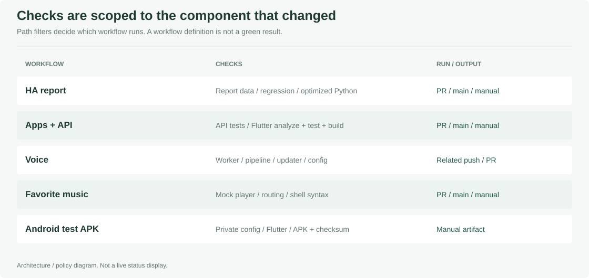
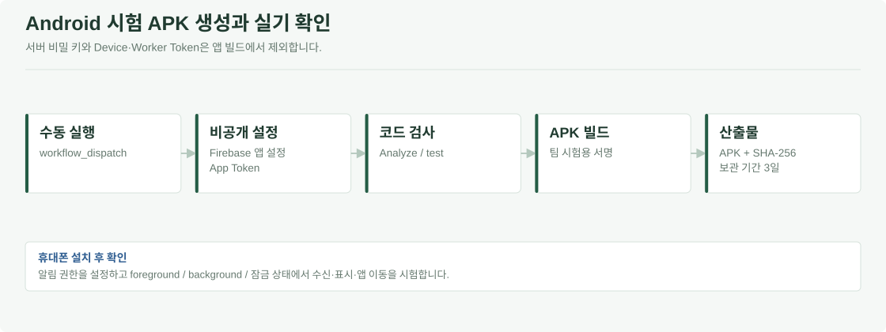

# 🧪 Memolink 자동 검사와 앱 빌드

HA 보고서 검증, 앱·API, 음성 모델 처리와 음악 출력의 회귀 검사를 GitHub Actions로 실행합니다. Android 시험 APK는 수동 Workflow에서 생성합니다. 실제 서버·장치 설치 절차는 [배포 안내](../Pauseable.deploy/README.md)에 정리했습니다.

**CI는 코드를 바꿀 때 기존 기능이 깨졌는지 자동으로 검사하는 절차**입니다. GitHub Actions의 Workflow는 검사·빌드 순서를 정한 파일입니다. 검사 통과, APK 생성, 실제 휴대폰 알림 수신은 서로 다른 결과로 확인합니다.

[전체 프로젝트](../README.md) · [AI](../Pauseable.ai/README.md) · [Apps](../Pauseable.apps/README.md) · [Edge](../Pauseable.edge/README.md)

[자동 검사 구성](#자동-검사-구성) · [기준 환경](#기준-환경) · [Android 시험 APK](#android-시험-apk) · [실기 검증 구분](#자동-검사와-실기-검증의-차이)

## 자동 검사 구성

<strong>Workflow 파일·실행 조건·산출물</strong>

| 파일 | 검사·산출물 | 주요 실행 조건 |
| --- | --- | --- |
| [`ha-report-checks.yml`](workflows/ha-report-checks.yml) | HA report regression, 일반·`python -O` 검사 | 관련 경로 PR·main push·수동 |
| [`native-alert-checks.yml`](workflows/native-alert-checks.yml) | API tests·공유 catalog·웹 알림·날씨, Flutter analyze/test/web/APK | 관련 경로 PR·main push·수동 |
| [`voice-checks.yml`](workflows/voice-checks.yml) | Worker/pipeline tests·Python compile·설정 JSON·모델 updater tests | 관련 경로 push·PR |
| [`favorite-music-checks.yml`](workflows/favorite-music-checks.yml) | 음악 Player·라우팅 회귀·Shell 문법 | 관련 경로 PR·main push·수동 |
| [`native-push-apk.yml`](workflows/native-push-apk.yml) | 비공개 팀 시험 APK와 SHA-256 | `workflow_dispatch` 수동 실행 |

경로 조건의 정확한 목록은 각 workflow의 `on` 정의를 확인합니다. README만 바뀐 commit에서는 경로 필터 때문에 일부 또는 전부가 실행되지 않을 수 있습니다.

## 기준 환경

| 영역 | 정의된 환경 |
| --- | --- |
| HA report·API·Favorite Music | Python 3.12 |
| Voice 검사 | Python 3.11 |
| Flutter | Flutter 3.47.6 |
| Android 빌드 | JDK 17, Android SDK 36, workflow의 실행기 설정 |

의존성은 각 파트의 `requirements`·`pubspec`과 Workflow에 정의합니다. Python 환경은 AI·API·Voice별로 분리합니다.

## Android 시험 APK

Actions의 **Build Android push test APK → Run workflow**에서 실행합니다. 빌드 후 APK와 SHA-256을 산출물로 제공하며, 휴대폰에 설치해 알림 권한과 수신 상태를 시험합니다.

<strong>APK 빌드에 필요한 설정</strong>

| 설정 | 용도 |
| --- | --- |
| Actions Variable `PAUSEABLE_FIREBASE_ANDROID_CONFIG_JSON` | Android 앱의 Firebase 클라이언트 설정 |
| Actions Secret `PAUSEABLE_APP_TOKEN` | 비공개 팀 시험 앱의 API 인증 |

서버용 Firebase 서비스 계정 JSON·Device Token·Worker Token·R2 키는 APK 빌드에 넣지 않습니다. 서비스 계정과 `google-services.json`은 서로 다른 파일입니다.

수동 APK workflow는 비공개 `RACOS-Team/Pauseable`에서 실행되도록 제한되어 있고 artifact 보관 기간은 3일입니다. 현재 공유 App Token·시험용 서명 빌드는 공개 배포용 인증·릴리스 체계를 대신하지 않습니다. 상세 준비와 실제 휴대폰 수신 확인은 [Android Push 안내](../Pauseable.apps/guardian/docs/ANDROID_PUSH_SETUP_KO.md)를 따릅니다.

## 자동 검사와 실기 검증의 차이

| CI에서 확인하는 것 | 별도 확인할 것 |
| --- | --- |
| 모의 API·플레이어와 회귀 테스트 | 실제 Render·YouTube·Pi 화면·스피커 |
| Flutter 분석·테스트·빌드 | 설치한 휴대폰의 알림 권한·FCM 수신·잠금 화면 |
| report 데이터·검증 로직 | 실제 가구 데이터·장기 운영·탐지 성능 |
| Worker·모델 교체 코드 | GPU 학습·R2 게시·Pi 설치·로컬 합성 |

검사 결과는 대상 commit의 Actions 실행 기록으로 확인합니다. 현재 CI는 모의 입력과 파트별 검사를 수행하며, 센서부터 가전·휴대폰 출력까지의 실기 E2E는 별도 시험으로 관리합니다.

## 검사 유지 기준

1. 수정하는 파트의 테스트와 경로 필터를 확인합니다.
2. 공유 계약 변경이면 producer·consumer 회귀 검사도 확인합니다.
3. 테스트·인증·권한 조건의 변경은 기능 변경과 함께 검토합니다.
4. 실제 장치 동작이나 Push 발송을 CI에 추가할 때는 모의 시험과 명확히 분리합니다.
