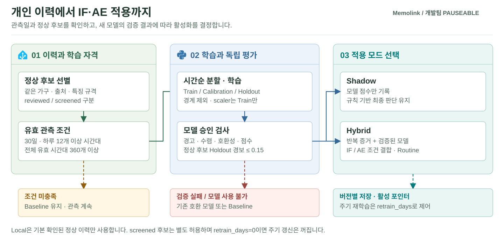
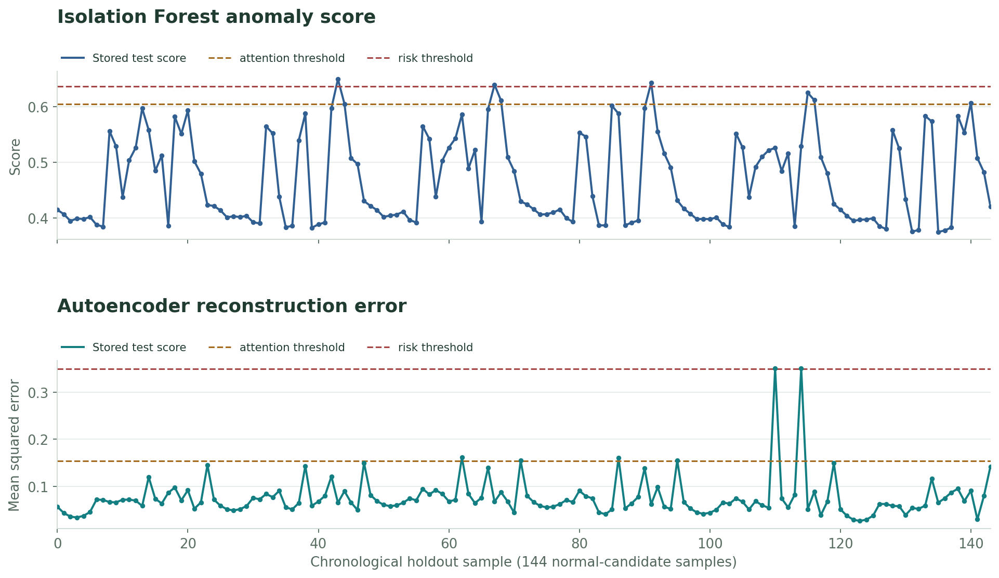
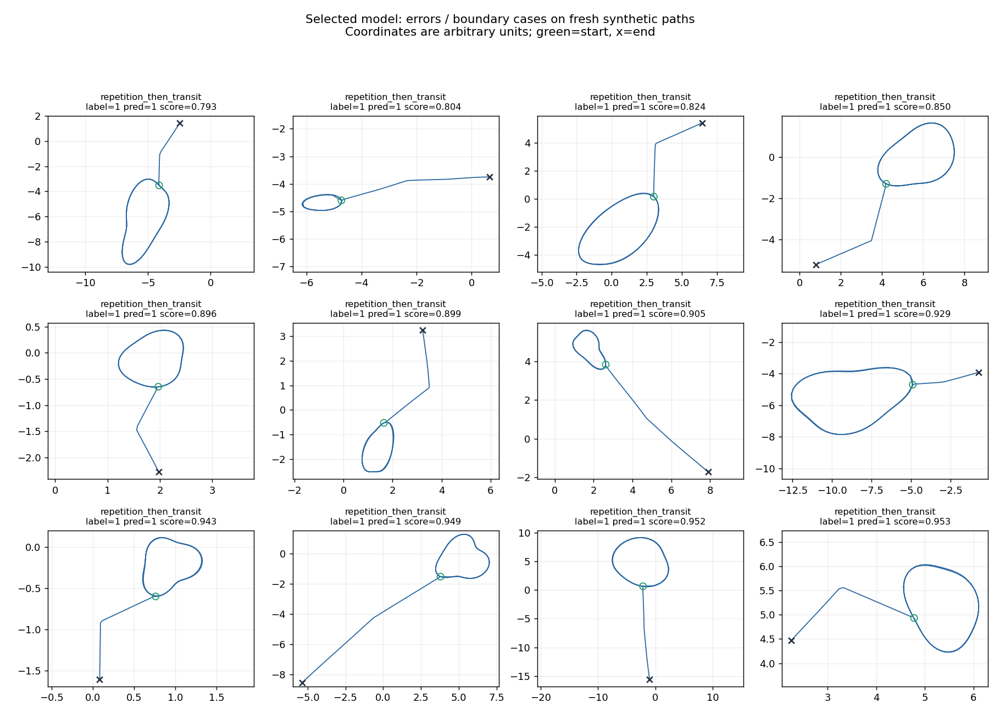
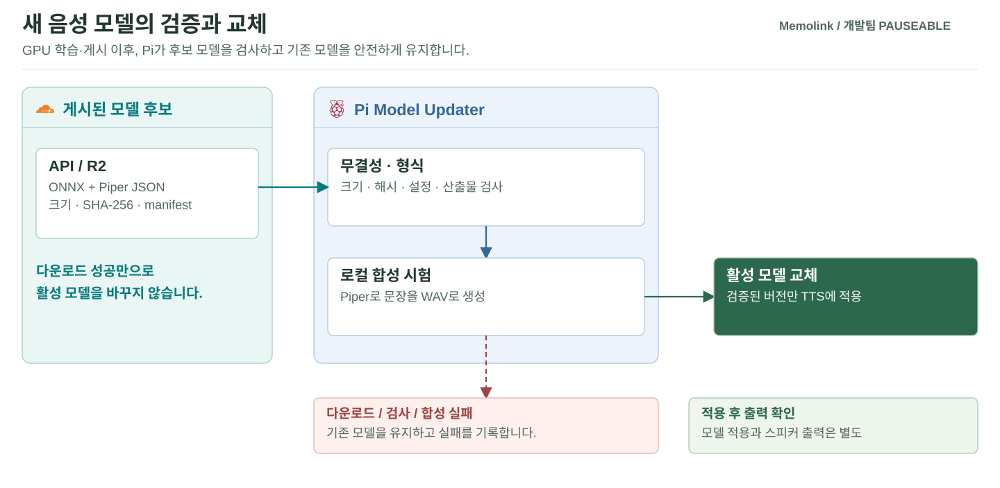

# Pauseable.ai

<a id="pauseableai"></a>

<a id="3-lifecycle-학습-시점검증모델-교체"></a>
<a id="ha-데이터-수집과-특징-생성"></a>
<a id="수집특징실행-주기"></a>

**가전 반복행동 분석, mmWave 배회 의심 판단, 보호자 음성 학습을 담당합니다.**

[프로젝트](../README.md) · [통신 규격](../Pauseable.contracts/README.md) · [장치 실행](../Pauseable.edge/README.md)

[모듈 개요](#모듈-개요) · [폴더 구조](#폴더-구조) · [HA 반복행동 분석](#ha-반복행동-분석) · [mmWave 배회 의심 판단](#mmwave-배회-의심-판단) · [보호자 음성 학습](#보호자-음성-학습)

<a id="모듈-개요"></a>

## 모듈 개요

| 모듈 | 입력 | 처리 | 출력 |
| --- | --- | --- | --- |
| `ha/` | Home Assistant 상태 변경·관측 품질 | 54개 특징, Baseline·IF·AE·Routine | 반복행동 판단 JSON |
| `mmwave/` | 대상 좌표·시각·추적 품질 | 경로 형태·개인 변화·지속성 | 배회 의심 판단 JSON |
| `voice/` | 동의한 WAV·문장 대본 | 전처리·Piper fine-tuning·Export | ONNX·설정·모델 Manifest |


행동 AI는 MQTT로 판단을 전달하고, 실제 실행 여부는 Central이 결정합니다. Voice는 Pi에서 새 안내 문장을 합성할 음성 모델을 만드는 모듈입니다.

<a id="폴더-구조"></a>

## 폴더 구조

```text
Pauseable.ai/
├── assets/
│   └── data/
├── ha/                               # 가전 이벤트 수집·개인화·반복행동 판단
│   ├── data/
│   │   └── raw/
│   │       └── baseline_scenarios/   # Baseline 비교용 합성 가전 이벤트 CSV
│   ├── deploy/
│   │   ├── contracts/                # HA 추론·피드백 메시지 규격
│   │   ├── public_power/             # 공개 전력 자료 변환·실험 설정
│   │   ├── research/                 # 연구 실행·시험 Broker 설정
│   │   └── systemd/
│   ├── scripts/
│   ├── src/
│   │   ├── collect_ha_events_ws.py   # HA 상태 변경 이벤트 수집
│   │   ├── ha_decision_delivery.py   # 공통 판단 계약 변환과 MQTT 전달
│   │   └── run_ha_full_service.py    # 수집·분석·개인 모델 처리 실행
│   ├── tests/
│   └── requirements.txt              # HA 분석 모듈 의존성
├── mmwave/                           # 이동 경로·개인 변화·지속성 판단
│   └── src/
│       ├── shape_v2/                 # 36개 경로 특징과 Random Forest 학습·추론
│       │   ├── artifacts/            # 저장된 모델·선택 결과·학습 출처
│       │   ├── examples/
│       │   └── legacy/
│       ├── wandering_live.py         # 센서 스트림의 배회 분석 실행
│       └── wandering_publisher.py    # 배회 판단의 MQTT 발행
└── voice/                            # 녹음 전처리·Piper 학습·모델 게시
    ├── configs/                      # 학습·실행 설정
    ├── docker/                       # 컨테이너 실행·빌드 구성
    ├── pipeline/                     # 자료 검사·Job Worker·학습 실행·게시
    │   ├── prepare_dataset.py        # WAV·대본과 학습 자료 검사
    │   └── r2_worker.py              # 음성 학습 Job 임대·갱신·게시
    ├── provenance/                   # Piper 원본 태그·커밋·프로젝트 수정 기록
    ├── scripts/
    ├── serving/                      # HTTP 음성 합성 서버
    │   └── main.py                   # HTTP 음성 합성 API
    └── train_voice_model.sh          # GPU 음성 학습과 Export 실행
```

`ha/deploy`는 장치의 수집·분석 서비스를, `mmwave/src/shape_v2`는 RF 모델의 학습·추론을 구성합니다. `voice/pipeline`은 음성 학습 작업을 관리하고 `voice/serving`은 HTTP 합성 API를 제공합니다.

<a id="ha-반복행동-판단"></a>
<a id="ha-가전-이벤트-수집과-특징-생성"></a>
<a id="수집특징생성-주기"></a>

<a id="ha-반복행동-분석"></a>

## HA 반복행동 분석

<a id="이벤트에서-특징까지"></a>

### ① 이벤트에서 특징까지

1. [collect_ha_events_ws.py](ha/src/collect_ha_events_ws.py)가 HA WebSocket의 `state_changed`를 수집합니다.
2. 엔티티와 상태를 열림·잠금 해제·작동 시작 등 의미 있는 가전 동작으로 바꿉니다.
3. 최근 10분·30분·1시간·2시간의 사용 횟수, 전환, 재시작과 시간 정보를 54개 특징으로 요약합니다.
4. 관측 누락·단절을 함께 확인해 사용하지 않은 상태와 관측하지 못한 상태를 구분합니다.

이벤트는 상태가 바뀔 때마다 기록합니다. 분석할 때는 1분 간격의 기준 시각마다 과거 이력을 요약합니다. [지속 실행 서비스](ha/src/run_ha_full_service.py)의 기본 분석 간격은 `--cycle-seconds 600`이고, 제출용 서비스 예시는 이를 60초로 설정합니다. MQTT에는 각 분석 회차의 최신 판정을 전달하며, 보호자 재알림 간격은 Central에서 별도로 관리합니다.


위쪽은 시간당 상태 변경 횟수, 아래쪽은 학습 구간 scaler로 표준화한 특징입니다. 원본은 합성 48시간·52개 상태 변경이며 아래쪽 색만 −2~4로 제한합니다. [원본 JSON](assets/data/visual_data.json)

<a id="baseline과-개인화-모델"></a>
<a id="3-lifecycle-학습-승인과-모델-교체"></a>

<a id="baseline과-개인화"></a>

### ② Baseline과 개인화

| 단계 | 작동 방식 |
| --- | --- |
| 초기 Baseline | 정상 참조의 특징별 분위수·IQR 상한과 최소 반복 횟수·패턴 규칙을 사용 |
| 정상 후보 선별 | 같은 가구·출처·특징 버전의 유효 이력을 사용 |
| 개인 모델 학습 | Isolation Forest(IF)는 정상 특징의 분포를, Autoencoder(AE)는 입력을 복원하는 패턴을 학습 |
| 모델 점수 계산 | IF는 정상 분포에서 벗어난 정도를, AE는 입력과 복원값의 차이를 계산 |
| 검증·승인 | 수렴·호환성·무결성·정상 후보 Holdout 경보 비율 검사 |
| Hybrid | 실제 반복 증거와 모델 신호를 함께 사용 |
| Routine | 확인된 생활패턴이 있는 경우 제한된 조건에서 경보 보정 |

[build_baseline.py](ha/src/build_baseline.py)는 정상 참조에서 분위수와 IQR 상한을 저장하고, [infer_ha_baseline.py](ha/src/infer_ha_baseline.py)는 최소 횟수를 충족하면서 상한을 넘은 특징에 점수를 부여합니다. 여기에 가전별 반복 패턴과 야간 조건을 함께 적용합니다.

기본 최초 학습 조건은 정상 후보로 선별된 완전한 관측 이력에서 하루 12개 이상의 서로 다른 1시간 구간을 확보한 날이 30일 이상이고, 전체 관측 구간이 360개 이상인 것입니다. `shadow`는 모델 점수를 기록하면서 Baseline 판정을 유지하고, `hybrid`는 반복 증거와 모델 신호를 함께 적용합니다. `--retrain-days 0`이면 최초 학습 이후 주기 재학습은 꺼져 있습니다. 검증 실패 시 기존 호환 모델 또는 Baseline을 유지합니다.



Routine은 요일·4시간 시간대·반복 패턴의 확인된 정상 이력을 사용합니다. 관측 품질, IF·AE의 Normal 상태와 보호 규칙을 확인합니다.

<a id="판단-전달"></a>

### ③ 판단 전달

[ha_decision_delivery.py](ha/src/ha_decision_delivery.py)가 현재 판단을 공통 계약으로 변환합니다. `attention/risk`는 계약의 `caution/danger`로 옮기고 관측 부족·오류는 `unknown`으로 보냅니다. MQTT Topic은 `pauseable/ai/repetitive/decision`이며 서비스의 `--publish-mqtt`로 명시적으로 활성화합니다.

<a id="ha-평가-결과"></a>
<a id="데이터-출처와-검증-기준"></a>

<a id="저장된-합성-평가"></a>

### ④ 저장된 합성 평가


| 조건 | Baseline | Hybrid | 해석 |
| --- | --- | --- | --- |
| 반복 가설 24개 | 16/24 | 24/24 | 경보가 발생한 시나리오 수 |
| 정상 맥락 48개 | 22/48 | 30/48 | 정상 사용에서도 경보가 증가 |

같은 규칙·반복 조건·관측 마스크를 유지한 비교이며 Routine 보정은 미적용입니다. [비교 원본](assets/data/baseline_comparison.json)



이 그림은 정상 후보 Holdout 144개 시점의 IF 점수·AE 재구성 오차와 Calibration에서 정한 임계값을 보여줍니다. 학습 중 Loss의 변화가 아니라 평가 구간의 점수입니다. [그림별 출처·분모](assets/evaluation_figure_manifest.json)

<a id="mmwave-구현과-설치-상세"></a>

<a id="mmwave-배회-의심-판단"></a>

## mmWave 배회 의심 판단

| 단계 | 코드 | 역할 |
| --- | --- | --- |
| 입력 구간 | [wandering_live.py](mmwave/src/wandering_live.py) | 관측 스트림을 입력받아 처리 |
| 상태 관리 | [wandering_runtime.py](mmwave/src/wandering_runtime.py) | 대상·출처별 구간과 상태 유지 |
| 경로 형태 | [shape_v2](mmwave/src/shape_v2) | 36개 특징과 저장된 Random Forest |
| 개인 변화 | [personal_baseline.py](mmwave/src/personal_baseline.py) | 별도 9개 특징의 개인 이력 비교 |
| 지속성 | [temporal_evidence.py](mmwave/src/temporal_evidence.py) | 연속 구간·누적 시간·시작/해제 경계 |
| 판단 전송 | [wandering_publisher.py](mmwave/src/wandering_publisher.py) | `pauseable/ai/wandering/decision` 발행 |

기본 정책은 높은 증거가 3개 연속 구간·총 90초 이상 이어지는 경우 후보를 만듭니다. 저장된 [RF 모델](mmwave/src/shape_v2/artifacts/model.json)의 시작 기준은 `decision_threshold=0.66`이며, 개인 변화는 P95에서 시작해 P90 미만에서 해제합니다. 개인 이력이 없으면 개인 변화 분석은 `unavailable`로 유지하고, 경로 형태 분석과 구분합니다.



초록 원은 시작, ×는 끝입니다. 좌표는 임의 단위이며 `label`은 생성 규칙, `pred`는 분류 결과, `score`는 보정되지 않은 점수입니다. [실험 설계](mmwave/src/shape_v2/PROTOCOL.md)

저장소의 센서 입력 구현은 [Serial 릴레이](../Pauseable.edge/mmwave-relay)와 Pi 5 FIFO를 포함합니다. Pi가 ESP32에 전원만 공급하는 구성에서는 그 Pi가 중계하지 않습니다. ESP32 Wi-Fi 직결을 사용할 때는 별도 펌웨어와 UDP 수신→AI 입력 전달까지 맞춰야 합니다.

<a id="voice-학습과-운영-상세"></a>

<a id="보호자-음성-학습"></a>

## 보호자 음성 학습

```text
동의·문장별 녹음 → WAV·대본 검사 → 전처리 → Piper 학습
→ ONNX·설정·Manifest 게시 → Pi 다운로드·시험 합성 → 활성 모델 교체
```

| 구성 | 담당 파일 |
| --- | --- |
| 자료·대본 검사 | [prepare_dataset.py](voice/pipeline/prepare_dataset.py) |
| WAV 전처리 | [preprocess.py](voice/scripts/preprocess.py) |
| 학습 실행 | [train_voice_model.sh](voice/train_voice_model.sh) |
| Job 임대·갱신·게시 | [r2_worker.py](voice/pipeline/r2_worker.py) |
| 모델 게시 | [publish_voice_model.py](voice/pipeline/publish_voice_model.py) |
| Pi 설치·교체 | [voice-model](../Pauseable.edge/voice-model) |

앱 대본은 160문장이며 준비 단계는 160~240 WAV를 검사합니다. 앱은 PCM16·16 kHz·mono로 수집하고 학습 전처리에서 22,050 Hz·mono·PCM16으로 맞춥니다. 학습에는 GPU 환경이 필요하며 Pi에서는 학습 완료 모델로 새 안내 문장을 합성합니다.



개인화 ONNX와 장치용 Piper 실행 파일은 별도로 준비합니다. 업로드·학습·게시·Pi 설치·실제 스피커 출력은 각각 확인합니다.

<a id="ha-구현과-실행-상세"></a>
<a id="로컬-검사"></a>

<a id="설치-및-로컬-검사"></a>

## 설치 및 로컬 검사

HA·mmWave·Voice는 의존성이 달라 별도 가상환경을 사용합니다. 아래 명령은 저장소 루트 기준입니다.

| 모듈 | 의존성 | 검사 |
| --- | --- | --- |
| HA·Python 3.12 | `python -m pip install -r Pauseable.ai/ha/requirements.txt` | `python -m unittest discover -s Pauseable.ai/ha/tests -v` |
| mmWave | `python -m pip install -r Pauseable.ai/mmwave/requirements.txt` | `python -m unittest discover -s Pauseable.ai/mmwave/src -p 'test_*.py' -v` |
| Voice Worker·Python 3.11 | `python -m pip install -r Pauseable.ai/voice/requirements.worker.txt` | `python -m unittest discover -s Pauseable.ai/voice/pipeline -p 'test_*.py' -v` |

장치 실행은 [HA systemd](ha/deploy/systemd), [Pi 5 Publisher](../Pauseable.deploy/mmwave-autostart/pi5), [GPU Worker](../Pauseable.deploy/gpu/voice-worker)를 기준으로 설정합니다. 실제 HA Token·MQTT·기존 모델·가구 ID와 상태 경로를 함께 준비합니다.

처음 HA를 설치할 때는 [환경 예시](ha/deploy/systemd/ha-ai.env.example), [엔티티 매핑](ha/src/entity_mapper.py), [제출용 서비스](ha/deploy/systemd/ha-ai-submission.service.example)를 함께 맞춥니다. 제출 예시는 shadow·60초 회차·MQTT 발행을 사용하며, 기존 `ha-ai-full.service`는 hybrid와 이전 설치 경로를 포함합니다. 동일 이력 경로에는 수집 서비스를 하나 선택해 실행합니다. `Dockerfile.pi`는 기본 명령으로 `run_ha_automation_loop.py --help`를 제공하며, 지속 수집은 서비스의 실행 명령과 옵션으로 설정합니다.

Voice Worker는 `fcntl`을 사용하는 Linux·WSL의 Python 3.11 환경에서 검사합니다. `voice/`에서 `python pipeline/r2_worker.py --dry-run --dataset-dir LOCAL_DATASET_DIR`를 실행하면 로컬 WAV·대본의 검사 결과를 확인할 수 있습니다.
