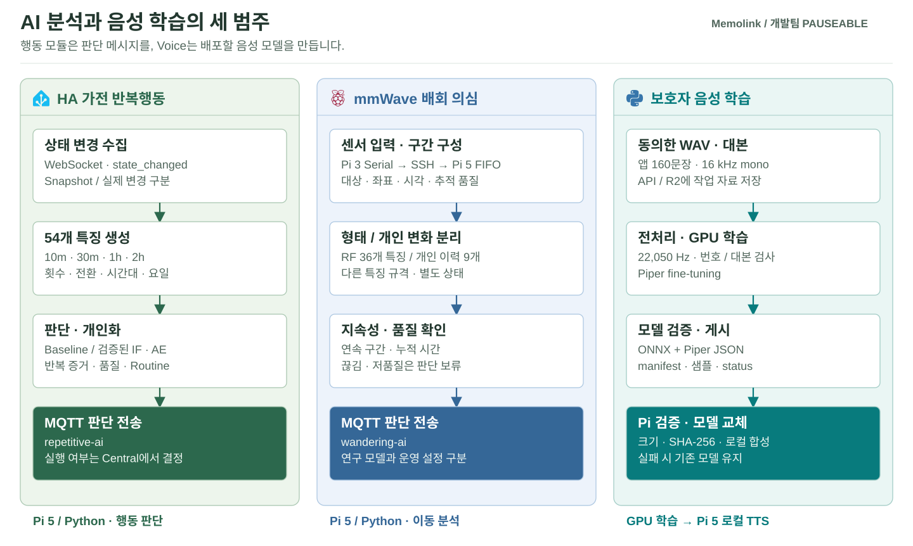
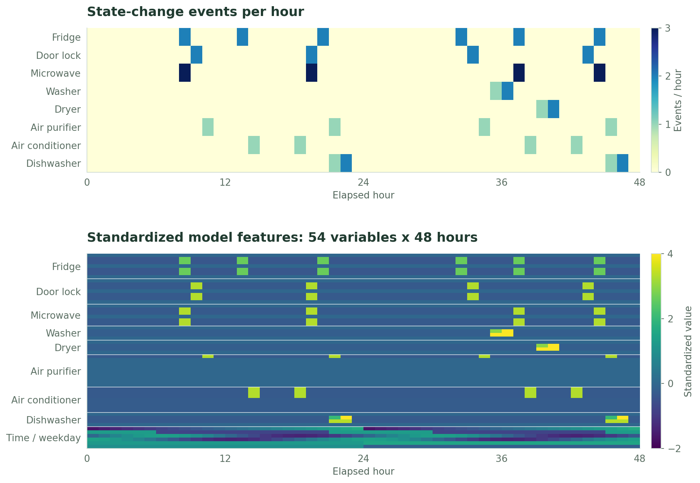
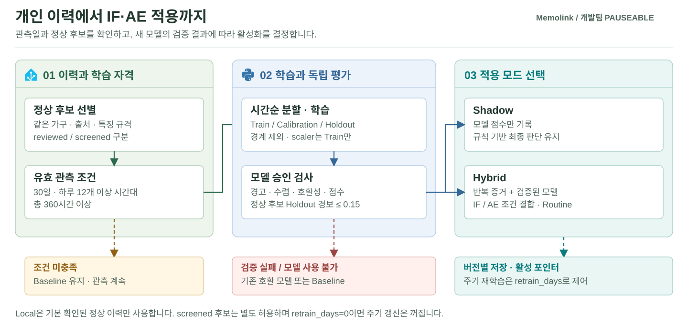
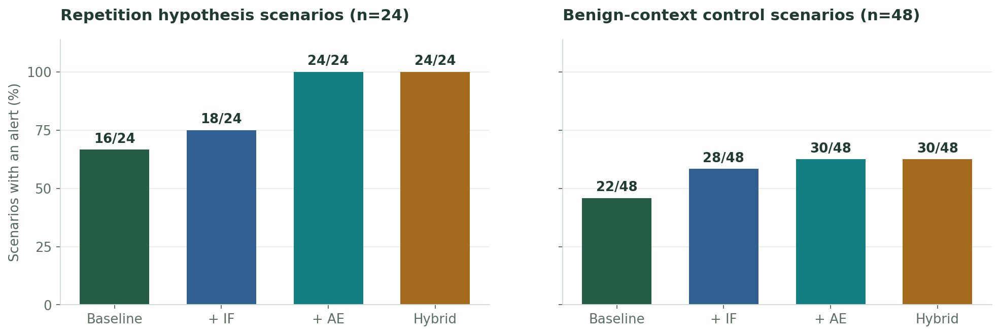

# Memolink / AI

가전 반복행동 분석, mmWave 이동 경로 분석, 보호자 음성 모델 학습을 구현한 영역입니다. HA·mmWave 모듈은 판단 결과를 MQTT로 전달하고, Voice 모듈은 Pi에서 사용할 Piper 음성 모델을 생성합니다. 판단 결과에 따른 실행 여부는 [Central](../Pauseable.edge/README.md)이 결정합니다.

[전체 프로젝트](../README.md) · [통신 계약](../Pauseable.contracts/README.md) · [검증 자료](../Pauseable.docs/README.md)



| 파트 | 입력 → 출력 | 실행 환경 | 코드 |
| --- | --- | --- | --- |
| HA | 가전 상태 이력 → 특징·판정·MQTT | Pi 5 / Python·Docker | [`ha`](ha) |
| mmWave | 이동 경로 → 형태·개인 변화·판단 근거 | Pi 5 / Python, 연구 도구 | [`mmwave`](mmwave) |
| Voice | 동의한 녹음·대본 → Piper ONNX | GPU Worker / Docker | [`voice`](voice) |

## HA 데이터 수집과 특징 생성

HA의 `state_changed` 이벤트를 WebSocket으로 구독해 상태 변경을 기록합니다. 저장된 이력으로 **1분마다 최근 10분·30분·1시간·2시간의 특징**을 생성합니다. 짧은 구간에서는 연속 조작을, 긴 구간에서는 일정 간격의 반복과 재시작을 확인합니다.

아래 HA 그래프는 동일한 합성 평가 자료를 사용했습니다. 실제 환자의 가전 사용 기록은 아닙니다. [평가 데이터](../Pauseable.docs/evaluation/ha/visual_data.json)와 [그림별 수치·출처](../Pauseable.docs/assets/readme/evaluation_figure_manifest.json)를 함께 제공합니다.



| 그림 | 읽는 방법 | 처리 의미 |
| --- | --- | --- |
| 위: Raw Event | 가로 48시간, 세로 8개 가전, 색은 시간당 상태 변경 횟수 | 열림·닫힘 등 상태 전환 기록. 사용 횟수와 반드시 같지는 않음 |
| 아래: Feature | 같은 48개 시점에서 54개 수치 특징을 표시 | 가전별 횟수·지속·전환·시간대·요일을 모델 입력으로 구성 |
| Color scale | 위는 횟수, 아래는 표준화 값으로 단위가 다름 | 학습 구간의 scaler 적용. 아래 색만 −2~4로 제한하고 원래 값은 유지 |

수집은 1분 단위 조회가 아니라 이벤트 방식이므로, HA가 전달한 2초 간격의 열림·닫힘도 기록할 수 있습니다. 제조사나 HA가 전달하지 않은 변화는 수집할 수 없으며, 초기 상태 Snapshot은 실제 상태 변경과 구분합니다.

## 반복행동 판단과 개인화

### Baseline

[`build_baseline.py`](ha/src/build_baseline.py)는 정상 참조 특징에서 분위수와 IQR을 계산해 기준값을 생성합니다. [`infer_ha_baseline.py`](ha/src/infer_ha_baseline.py)는 이 기준값에 최소 조작 횟수, 가전별 반복 규칙과 야간 정보를 적용해 점수와 판단 근거를 산출합니다. 기준을 실제 사용자 이력으로 만들기 전에는 개인화된 기준으로 해석하지 않습니다.

특징에는 냉장고 열림, 도어락 해제, 전자레인지 시작, 세탁기·건조기·식기세척기 재시작, 공기청정기·에어컨의 반복 조작 등이 포함됩니다. 분석 대상은 HA 엔티티 선택과 상태 매핑으로 설정합니다. 동일한 외형의 반복이라도 정상적인 사용 목적이 있을 수 있으므로, 관측 품질과 확인된 개인 생활패턴을 함께 반영합니다.

### IF·AE 학습과 적용

유효한 정상 이력이 쌓이면 Isolation Forest와 Autoencoder를 학습하고 검증합니다. Baseline을 유지한 상태에서 모델 점수를 관찰하는 `shadow`와, 반복 증거·개인 생활패턴을 함께 적용하는 `hybrid`를 구분했습니다.



| 운용 단계 | 처리 |
| --- | --- |
| 이력 부족 | Baseline 사용. 관측 부족을 정상으로 간주하지 않음 |
| 학습 조건 충족 | 같은 가구·출처·특징 규격의 정상 후보로 IF/AE 학습 |
| `shadow` | 모델 점수만 비교하고 최종 규칙 경보는 유지 |
| `hybrid` | 반복 증거·관측 품질·Routine 정책을 확인하고 검증된 모델 점수 결합 |
| 모델 손상·호환성 불일치 | Baseline fallback. 검증되지 않은 모델은 사용하지 않음 |

- 기본 최초 학습 조건은 하루 12개 이상 서로 다른 시간대에 유효 정상 후보가 있는 날 **30일 이상**입니다. 단순히 달력상 한 달이 지났다는 뜻은 아닙니다.
- `baseline_screened`는 규칙으로 선별한 정상 후보, `reviewed_normal`은 사람이 확인한 정상 이력입니다. 둘을 같은 정답으로 취급하지 않습니다.
- Local 이력은 기본적으로 확인된 정상 이력을 사용하며, Baseline 선별 후보까지 학습에 쓰려면 별도 허용 설정이 필요합니다. 이력 수집만으로 모든 행이 학습 대상으로 승인되지는 않습니다.
- IF는 정상 후보 분포에서 벗어나는 정도를, AE는 입력 특징의 Reconstruction Error를 계산합니다. 두 점수를 단순 평균하지 않습니다.
- 재학습은 `retrain_days`와 새 유효 이력 조건으로 제어합니다. **`retrain_days=0`이면 주기적 재학습은 비활성**입니다. 코드 지원과 현재 Pi 설정은 별도로 확인합니다.

시간대·요일은 특징과 개인 생활패턴 판단에 사용합니다. 지난주 같은 요일의 사건 하나와 직접 대조하는 방식은 아닙니다. 연속된 이상 판정은 Episode로 묶어 기록합니다. 보호자의 안전 확인 응답과 학습용 정상 판정도 구분하며, 명시적으로 확인한 행동 평가만 학습·보정에 반영합니다.

## HA 평가 결과



반복 가설 24개에서 경보가 발생한 시나리오는 Baseline 16개, Hybrid 24개였습니다. 정상 맥락 48개에서도 각각 22개, 30개에 경보가 발생했습니다. 모델 추가로 경보 범위가 넓어졌지만, 정상 사용을 경보로 판단한 사례가 남았습니다. [방법별 결과](../Pauseable.docs/evaluation/ha/baseline_comparison.json)

이 비교는 같은 Baseline·반복 증거·관측 마스크를 유지하고 모델 신호만 분리한 Ablation이며, **Routine 보정은 미적용**입니다. 경보 수는 `attention` 또는 `risk`가 한 번 이상 나온 시나리오 수입니다. 별도의 개인화 시험에서는 576개 시점 중 `attention` 6개가 정상으로 조정되고 `risk` 6개는 유지됐습니다. 두 시험은 평가 대상이 다르므로, 개인화 결과가 위 정상 맥락의 오탐 전체를 해결한 것으로 볼 수는 없습니다.


위 그래프는 정상 후보 Holdout 144개의 IF Score와 AE Reconstruction Error입니다. 모델마다 단위와 임계값이 다르며, 학습 중 Loss의 변화가 아니라 평가 입력에 대한 점수 변화를 나타냅니다.

| 저장된 학습 기록 | 값 | 해석 |
| --- | --- | --- |
| 입력 | 54개 수치 특징 | timestamp 제외 |
| 시간순 분할 | Train 428 / Calibration 142 / Holdout 144 | 학습·임계값 보정·평가 역할 분리, 경계 구간 제외 |
| AE 학습 | 337 iterations, 최종 Loss 약 0.0382 | 저장된 학습 요약값. 환자 탐지 정확도가 아님 |

학습 Loss는 저장된 최종값을 표기했습니다. iteration별 학습 곡선은 해당 평가 JSON에 포함되어 있지 않습니다. 데이터 분할과 재현 절차는 [평가 자료](../Pauseable.docs/README.md#평가-자료-읽기)에 정리했습니다.

## mmWave 경로 분석

이동 구간의 형태 특징과 개인 이력, 관측 품질을 확인하고 지속성을 판단합니다. 형태 점수가 잠시 높아졌다는 이유만으로 배회를 확정하지 않습니다.


위 그림은 `shape_v2` Random Forest에 합성 이동 경로를 입력한 결과입니다. 반복 이동 후 다른 곳으로 이동하는 경계 사례를 표시했으며, 좌표는 실제 미터 단위가 아닙니다. `label`은 생성 규칙의 정답, `pred`는 모델 분류, `score`는 보정되지 않은 모델 점수입니다. 실제 센서나 환자의 배회 기록으로 얻은 결과는 아닙니다.

저장된 평가의 출처는 `simulated_only`입니다. 실측 LD6004와 임상 배회 성능은 검증되지 않았으며, 해당 연구 모델의 자동 알림은 비활성입니다.

[Runtime·결과 해석](../Pauseable.docs/mmwave/RUNTIME.md) · [모델 프로토콜](mmwave/src/shape_v2/PROTOCOL.md) · [평가 원본](mmwave/src/shape_v2/artifacts/metrics.json)

## 개인화 Voice

Guardian 녹음과 대본을 API/R2에 등록하면 GPU Worker가 WAV·metadata 검사, Piper fine-tuning, ONNX Export와 산출물 검증을 수행합니다. Pi는 게시된 모델을 내려받아 검증한 뒤 교체합니다. HA의 IF/AE 학습과는 별도 경로입니다.

| 구분 | 계약 |
| --- | --- |
| 입력 | 160~240개 WAV와 대응하는 `recording_script.csv` |
| 앱 녹음 | 16 kHz, mono, PCM 16-bit. 현재 앱 고정 대본은 160문장 |
| 학습 전처리 | mono·22,050 Hz·PCM 16-bit로 변환, `S001.wav`부터 연속 번호와 대본 대조 |
| 산출물 | ONNX·Piper JSON·manifest·status·샘플 WAV·학습 로그 |
| 적용 | 크기·SHA-256·로컬 합성 검증 후 교체, 실패 시 기존 모델 유지 |

[GPU Worker 운영](../Pauseable.docs/voice/OPERATIONS_KO.md) · [데이터·동의·보관 정책](../Pauseable.docs/voice/DATA_AND_ARTIFACTS_KO.md) · [Pi 모델 교체 흐름](../Pauseable.edge/README.md#음성-모델-교체)

앱의 녹음 형식과 학습용 전처리 형식은 서로 다른 단계입니다. 변환은 [`preprocess.py`](voice/scripts/preprocess.py)가 수행하며 원본의 sample rate와 변환 결과를 기록합니다.

## 실행 준비와 주요 코드

실제 HA 연결에는 HA 주소·Token, MQTT 설정, 분석할 엔티티와 Baseline JSON이 필요합니다. 개인별 이력과 학습 모델은 별도 저장 경로에 준비합니다. 저장소의 연구용 데이터와 실제 가구의 이력·모델은 분리해 운용합니다.

<details>
<summary><strong>HA 코드 진입점과 로컬 검사</strong></summary>

| 단계 | 구현 | 핵심 내용 |
| --- | --- | --- |
| 수집 | [`collect_ha_events_ws.py`](ha/src/collect_ha_events_ws.py) | WebSocket 상태 변경·초기 상태·관측 정보 |
| 특징 | [`make_ha_features.py`](ha/src/make_ha_features.py) | 횟수·상태 전환·재시작·시간대·요일 |
| 학습 | [`train_ha_anomaly_models.py`](ha/src/train_ha_anomaly_models.py) | 정상 후보 IF/AE, 시간순 분할·보정·검증 |
| Lifecycle | [`ha_model_lifecycle.py`](ha/src/ha_model_lifecycle.py) | 이력·학습 조건·모델 적용·fallback·갱신 |
| 서비스 | [`run_ha_full_service.py`](ha/src/run_ha_full_service.py) | 수집·주기적 분석 실행 관리 |

Python 3.12 별도 가상환경을 활성화한 뒤 **저장소 루트에서** 실행합니다.

```sh
python -m pip install -r Pauseable.ai/ha/requirements.txt
python -m unittest discover -s Pauseable.ai/ha/tests -v
python -m unittest discover -s Pauseable.docs/evaluation/ha/checks -v
```

Docker 연구 환경: [`Dockerfile.research`](ha/Dockerfile.research), [`compose.research.yaml`](ha/compose.research.yaml). 실제 가구 이력·모델 경로와 연구 출력을 분리합니다.

[실시간 수집](../Pauseable.docs/ha/ha_realtime_collection_guide.md) · [개인화·이상 탐지](../Pauseable.docs/ha/ha_anomaly_shadow_guide.md) · [시연 절차](../Pauseable.docs/ha/DEMO_RUNBOOK_KO.md)

</details>

<details>
<summary><strong>mmWave 코드 진입점</strong></summary>

| 구분 | 위치 | 역할 |
| --- | --- | --- |
| 실시간 연결 | [`wandering_runtime.py`](mmwave/src/wandering_runtime.py), [`wandering_live.py`](mmwave/src/wandering_live.py) | 입력·구간·상태 |
| 개인 이력 | [`personal_baseline.py`](mmwave/src/personal_baseline.py) | 과거 기록과 비교 |
| 메시지 | [`wandering_publisher.py`](mmwave/src/wandering_publisher.py) | 계약에 맞는 MQTT 출력 |
| 형태 연구 | [`shape_v2`](mmwave/src/shape_v2) | Random Forest 경로 분석·재현 가능한 평가 |

</details>

## 데이터와 검증 범위

공개 전력·활동 데이터, 문헌을 참고한 합성 시나리오, 실제 사용자 이력은 출처와 용도를 구분합니다. 공개 전력 데이터를 치매 환자의 반복행동 정답으로 사용하지 않습니다. [공개 데이터 검토](../Pauseable.docs/ha/public_power_data_guide.md), [문헌 기반 시나리오](../Pauseable.docs/ha/EVIDENCE_RESEARCH_20261005_KO.md), [Baseline 검증 절차](../Pauseable.docs/ha/ha_baseline_validation_protocol.md)를 제공합니다.

현재 제시한 HA·경로 형태 평가는 소프트웨어 동작과 시나리오 분류를 확인한 결과이며, 실제 환자 탐지 성능은 추가 검증이 필요합니다. 원본 녹음·개인 이력·checkpoint·개인화 ONNX·인증값은 저장소에서 제외합니다.
