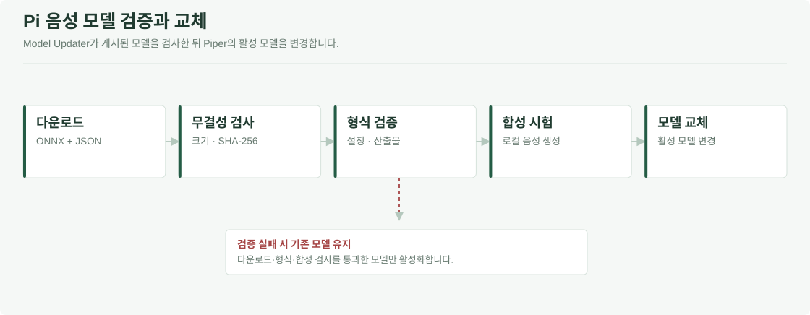

# AI 분석과 보호자 음성 학습

이 폴더에는 입력과 목적이 다른 세 프로그램이 있습니다. **HA는 가전 사용을, mmWave는 실내 이동을 분석합니다. Voice는 안내에 사용할 보호자 음성 모델을 만듭니다.** 행동 분석 결과의 실행 여부는 [Central](../Pauseable.edge/README.md#central-app)이 결정합니다.

[전체 시스템](../README.md) · [통신 형식](../Pauseable.contracts/README.md) · [개발환경](../Pauseable.docs/DEVELOPMENT_ENVIRONMENT_KO.md)

| 범주 | 입력 | 결과 | 실행 위치 |
| --- | --- | --- | --- |
| [HA 반복행동](#ha-반복행동-판단) · `ha/` | Home Assistant 상태 변경 | 반복행동 판단 JSON | Pi 5 |
| [mmWave 배회](#mmwave-구현과-설치-상세) · `mmwave/` | 대상 위치·시각·품질 | 배회 의심 판단 JSON | Pi 5 |
| [Voice](#voice-학습과-운영-상세) · `voice/` | 동의한 녹음·대본 | Piper ONNX 음성 모델 | GPU Worker |


<a id="ha-반복행동-판단"></a>

## 1. HA: 가전 사용에서 반복행동 판단까지

### 1.1 상태 변경을 받는다

Home Assistant의 **엔티티**는 가전의 전원·문 상태·운전 모드 등을 나타내는 항목입니다. [collect_ha_events_ws.py](ha/src/collect_ha_events_ws.py)는 WebSocket으로 `state_changed`를 구독하고, 변경이 도착할 때 발생 시각·엔티티 ID·상태를 CSV에 기록합니다.

수집기는 연결 직후 초기 상태인 Snapshot과 연결 관측 정보도 기록합니다. Snapshot은 반복 사용 횟수에 넣지 않습니다. 열림과 닫힘이 각각 전달되면 짧은 개폐도 두 이벤트로 남지만, 가전이나 HA가 제공하지 않은 변화까지 복구하지는 않습니다.

### 1.2 원시 상태를 가전 동작으로 바꾼다

[entity_mapper.py](ha/src/entity_mapper.py)는 엔티티별 설정으로 상태를 `가전 종류`, `신호 종류`, `Action`으로 바꿉니다. 예를 들어 같은 `on/off`라도 문 센서인지 전원 스위치인지에 따라 다른 동작입니다. 알 수 없거나 사용할 수 없는 상태와 지원하지 않는 엔티티는 행동 횟수에서 제외합니다.

공통 특징 규격은 냉장고·도어락·전자레인지·세탁기·건조기·식기세척기·공기청정기·에어컨을 지원합니다. 실제 분석 대상은 연결한 엔티티와 매핑 설정으로 정합니다. 문 상태가 없는 전력 센서만으로 문 개폐를 계산하지 않습니다.

<a id="ha-데이터-수집과-특징-생성"></a>
<a id="수집특징실행-주기"></a>

### 1.3 최근 사용 이력을 54개 Feature로 만든다

[make_ha_features.py](ha/src/make_ha_features.py)는 기준 시각마다 과거 일정 구간의 기록을 요약합니다. 이 방식을 **Sliding Window**라고 합니다. 기준 시각을 1분 이동하면 조회 구간도 1분씩 이동합니다.

| 특징 범주 | 계산하는 정보 | 차원 |
| --- | --- | --- |
| 냉장고·도어락 | 개폐·잠금 해제·상태 전환·야간 횟수 | 14 |
| 세탁기·건조기·식기세척기 | 작동 변경·시작·완료 후 재시작 | 12 |
| 공기청정기·에어컨 | 전원·모드·풍량·설정 온도 변경 | 16 |
| 전자레인지 | 가열 시작·작동 변경·야간 가열 | 6 |
| 시간·요일 | 시각·야간 여부와 시간/요일의 주기 정보 | 6 |
| **합계** | 행동 48개와 시간·요일 6개 | **54** |

가전과 동작에 따라 10분·30분·1시간·2시간 구간을 사용합니다. 모든 특징에 네 구간이 전부 존재하는 것은 아닙니다. 짧은 구간은 집중된 조작을, 긴 구간은 반복의 지속이나 완료 후 재시작을 확인하는 데 사용합니다.

| 처리 | 기본 시점 |
| --- | --- |
| 상태 변경 기록 | WebSocket 이벤트 수신 시 |
| Feature 기준 시각 | 1분 간격 |
| 지속 서비스 분석 회차 | 이전 분석 종료 후 600초 대기 |

분석 사이에도 수집기는 계속 실행합니다. 인접 Feature는 같은 과거 기록을 공유하므로 Feature 행 수와 독립 사건 수는 다릅니다.


위쪽은 시간당 상태 변경 횟수, 아래쪽은 Train에서 학습한 scaler로 표준화한 54개 특징입니다. 같은 48시간의 합성 이력을 사용합니다. 아래쪽 색상만 −2~4로 제한하며 원래 값은 유지합니다. [원본 데이터](../Pauseable.docs/assets/readme/data/visual_data.json) · [그림별 출처](../Pauseable.docs/assets/readme/evaluation_figure_manifest.json)

<a id="baseline과-개인화-모델"></a>

### 1.4 Baseline으로 초기 판단을 만든다

개인 이력이 부족한 초기에는 정상 참조 이력으로 만든 Baseline을 사용합니다. [build_baseline.py](ha/src/build_baseline.py)가 특징별 통계 기준을 저장하고, [infer_ha_baseline.py](ha/src/infer_ha_baseline.py)가 현재 특징을 그 기준과 비교합니다.

1. 정상 참조에서 특징별 P90·P95·P99, Q1·Q3를 구합니다. IQR은 `Q3 - Q1`입니다.
2. 해당 특징의 최소 횟수인 `MinCount`를 확인합니다. 미만이면 그 특징은 0점입니다.
3. 아래 상한을 초과한 단계에 따라 특징 점수를 부여합니다.
4. 가전별 반복·재시작 패턴과 야간 점수를 더해 최종 점수와 근거를 만듭니다.

| 통계 상한 | 초과 단계의 점수 |
| --- | --- |
| `max(P90, Q3 + 1.0 * IQR)` | 5 |
| `max(P95, Q3 + 1.5 * IQR)` | 9 |
| `max(P99, Q3 + 2.0 * IQR)` | 14 |

기본 판정 경계는 **Attention 35점 이상, Risk 70점 이상**입니다. `MinCount`는 특징을 점수 계산에 포함하는 하한이지, 그 횟수만으로 경보를 확정하는 기준은 아닙니다. 시간대 통계를 저장하더라도 현재 기본 추론은 전체 참조 통계와 명시적인 야간 조건을 사용합니다.

### 1.5 개인 정상 이력으로 IF와 AE를 학습한다

[ha_model_lifecycle.py](ha/src/ha_model_lifecycle.py)가 학습 가능 여부와 모델 적용을 관리하고, [train_ha_anomaly_models.py](ha/src/train_ha_anomaly_models.py)가 학습을 수행합니다.

**먼저 학습 자료를 선별합니다.** 같은 가구·출처·특징 규격의 완전한 관측 구간만 사용합니다. `reviewed_normal`은 정상으로 검토한 이력이고, `baseline_screened`는 규칙으로 선별한 후보입니다. 실제 가구의 기본 설정은 `reviewed_normal`만 허용하며, 규칙 선별 후보 사용은 별도 옵션입니다.

**그다음 자료량을 확인합니다.** 자동 운용의 최초 학습은 하루 12개 이상의 서로 다른 시간대가 있는 유효일 30일, 전체 유효 시간대 360개 이상을 요구합니다. 시간대는 1시간 단위로 중복을 제거해 셉니다. 날짜가 한 달 지났다는 이유만으로 학습하지 않습니다.

**학습·보정·평가를 분리합니다.** 자료를 시간순으로 Train 60%, Calibration 20%, Holdout 20%로 나누고 각 경계 직전 2시간을 제외합니다. Train은 모델 학습, Calibration은 점수 경계 결정, Holdout은 적용 전 확인에 사용합니다.

| 모델 | 학습과 점수 계산 |
| --- | --- |
| Isolation Forest | 정상 특징 분포로 트리를 학습하고 적은 분할로 고립되는 입력에 높은 이상 점수 부여 |
| Autoencoder | Train에서 StandardScaler를 학습한 뒤 `54-16-6-16-54` MLP로 입력 복원. 표준화한 입력과 복원값의 MSE 계산 |
| 모델별 경계 | Calibration 점수의 P95를 Attention, P99를 Risk 경계로 사용 |

AE는 ReLU·Adam을 사용합니다. IF와 AE는 정상 사용과 다른 입력을 찾으며, 치매 여부를 직접 분류하도록 학습하지 않습니다.

<a id="3-lifecycle-학습-시점검증모델-교체"></a>

### 1.6 검증한 모델만 적용한다


학습이 끝나면 수렴 경고, 특징·가구 호환성, 파일 무결성, 점수 계산을 검사합니다. 정상 후보 Holdout에서 IF 또는 AE가 경보인 비율도 확인하며 기본 허용 상한은 15%입니다. 통과한 버전만 활성 모델로 지정합니다.

| 상태·설정 | 서비스 동작 |
| --- | --- |
| 자료 부족 | 수집을 계속하고 Baseline 유지 |
| `shadow` | 모델 점수 기록, 최종 규칙 판정 유지 |
| `hybrid` | 반복 증거가 있을 때 모델 점수를 최종 판정에 반영 |
| 학습·검증 실패 | 새 모델을 적용하지 않고 기존 호환 모델 또는 Baseline 유지 |
| `retrain_days=0` | 주기 재학습 비활성 |
| 재학습 활성 | 설정 기간 경과와 새 유효 시간대 24개 이상 등 확인 후 재학습 |

버전별 모델과 활성 포인터를 분리해 저장합니다. 오류가 발생한 새 모델로 기존 버전을 덮어쓰지 않습니다. 자동 운용의 30일 조건과 개별 학습 스크립트의 최소 입력 검사는 다른 설정입니다.

### 1.7 Baseline과 모델 결과를 결합한다

Hybrid는 세 점수를 단순 평균하지 않습니다. [Lifecycle의 `combine()`](ha/src/ha_model_lifecycle.py)이 실제 반복 증거와 모델 상태를 먼저 확인합니다.

| 조건 | 최종 처리 |
| --- | --- |
| 반복 증거 없음 | 모델 단독 이상을 반복행동 경보로 승격하지 않고 기록 |
| 검증된 모델·반복 증거·IF 또는 AE 경보 | 규칙이 Normal이면 Attention으로 승격 |
| 검증된 모델·반복 증거·IF와 AE 모두 Risk | Risk로 승격 가능 |
| 관측 불완전·추론 오류 | 통신 시 `unknown` 상태로 구분 |

### 1.8 확인된 생활패턴으로 경보를 보정한다

[ha_personal_routine.py](ha/src/ha_personal_routine.py)는 **요일·4시간 단위 시간대·반복 패턴**별 Routine 프로필을 만듭니다. 지난주 같은 요일의 사건 하나와 직접 비교하는 방식이 아니라, 여러 날짜의 정상 이력 범위를 사용합니다.

프로필은 확인된 정상 이력의 최근 45일에서 만들고, 최소 3일·30분 단위 표본 6개를 요구합니다. 보정 시에는 최근 관측 여부, 현재 횟수 조합을 지지하는 과거 날짜와 **IF·AE가 모두 Normal인지**를 확인합니다. 도어락·고밀도 반복 등 보호 규칙에 해당하면 보정하지 않습니다. 보호자의 안전 확인 응답도 학습용 정상 라벨로 자동 바꾸지 않습니다.

### 1.9 판단을 기록하고 Central에 보낸다

1. [summarize_ha_result.py](ha/src/summarize_ha_result.py)가 같은 주요 패턴의 연속 이상 판정을 Episode로 묶습니다. 기본 연결 간격은 최대 2분이며 시작·종료·최고 점수·근거를 저장합니다.
2. [ha_decision_delivery.py](ha/src/ha_decision_delivery.py)가 현재 판단을 [공통 계약](../Pauseable.contracts/README.md)의 JSON으로 바꿉니다.
3. MQTT 전송을 활성화하면 `pauseable/ai/repetitive/decision`에 보냅니다. 내부 `attention/risk`는 통신의 `caution/danger`로 변환합니다.
4. Central이 메시지와 실행 조건을 검사합니다. AI의 판단 생성과 TTS·가전 실행은 별도 단계입니다.

지속 서비스의 MQTT 전송은 `--publish-mqtt`로 명시적으로 활성화합니다. Episode 요약이 끝날 때까지 현재 판단 전송을 기다리는 구조는 아닙니다.

<a id="ha-구현과-실행-상세"></a>
<a id="로컬-검사"></a>

### 1.10 실행과 검사

Python 3.12의 별도 가상환경을 활성화한 뒤 **저장소 루트에서** 실행합니다.

```sh
python -m pip install -r Pauseable.ai/ha/requirements.txt
python -m unittest discover -s Pauseable.ai/ha/tests -v
```

| 실제 연결·운영 | 확인할 파일 |
| --- | --- |
| HA 주소·Token·엔티티 매핑 | [실시간 수집 가이드](ha/src/collect_ha_events_ws.py) |
| 지속 실행 | [run_ha_full_service.py](ha/src/run_ha_full_service.py), [systemd 설정](ha/deploy/systemd) |
| Pi 이미지 | [Dockerfile.pi](ha/Dockerfile.pi) |
| 연구·시뮬레이션 | [Dockerfile.research](ha/Dockerfile.research), [compose.research.yaml](ha/compose.research.yaml) |
| 시연 | [DEMO_RUNBOOK_KO.md](../Pauseable.apps/guardian/docs/REAL_DEVICE_ALERT_VERIFICATION.md) |

연구 데이터와 실제 가구 이력은 저장 경로·가구 ID·모델 버전을 분리합니다.

<a id="ha-평가-결과"></a>

### 1.11 저장된 평가 결과


| 시험 입력 | Baseline | Hybrid | 읽는 기준 |
| --- | --- | --- | --- |
| 반복 가설 24개 | 16/24 경보 | 24/24 경보 | 동일 규칙·관측 조건에서 모델 추가 비교 |
| 정상 맥락 48개 | 22/48 경보 | 30/48 경보 | 정상 사용 경보도 증가 |
| 별도 Routine 576시점 | Attention 6·Risk 6 | Attention 6개 Normal 보정, Risk 6개 유지 | 위 48개와 다른 시험 |

모델 비교는 합성 입력을 사용했고 Routine 보정은 미적용입니다. 경보 수는 Attention 또는 Risk가 한 번 이상 나온 시나리오 수로, 환자 대상 정확도가 아닙니다. 저장된 별도 학습 기록은 Train 428·Calibration 142·Holdout 144, AE 337 iterations·최종 Optimizer Loss 약 0.0382입니다. Loss와 탐지 성능은 구분해 읽습니다.


이 그래프는 Holdout의 모델 점수와 Calibration에서 정한 경계입니다. Training Loss 곡선은 아니며, 선택한 평가 JSON에는 iteration별 Loss 시계열이 없습니다.

[평가 원본과 조건](../Pauseable.docs/README.md#평가-자료-읽기) · [모델별 비교 JSON](../Pauseable.docs/assets/readme/data/baseline_comparison.json) · [시각 자료와 출처](../Pauseable.docs/assets/readme/ASSETS.md)

<a id="mmwave-구현과-설치-상세"></a>

## 2. mmWave: 위치 기록에서 배회 의심 판단까지

### 2.1 센서 기록을 Pi 5로 전달한다

LD6004/ESP32의 대상·좌표·시각·품질 정보는 Pi 3의 Serial 릴레이를 거칩니다. 릴레이는 계약을 확인하고 SSH로 Pi 5의 `/run/pauseable-wandering-input.fifo`에 전달합니다. 선택적 UDP 복사는 Central 관측·보관용이며, 행동 판단 MQTT와 다른 입력입니다.

### 2.2 이동 구간을 만든다

[wandering_live.py](mmwave/src/wandering_live.py)와 [wandering_runtime.py](mmwave/src/wandering_runtime.py)가 입력을 받아 대상·출처별 이동 구간을 만듭니다. 입력 단절·저품질·시간 역전이 있으면 증거를 초기화하거나 누적을 보류합니다.

### 2.3 경로 형태와 개인 변화를 따로 계산한다

| 분석 | 구현 | 사용하는 정보 |
| --- | --- | --- |
| 경로 형태 | [shape_v2](mmwave/src/shape_v2) | 36개 경로 특징과 Random Forest |
| 개인 변화 | [personal_baseline.py](mmwave/src/personal_baseline.py) | 별도 9개 특징 규격과 개인 이력 |
| 지속성 | [temporal_evidence.py](mmwave/src/temporal_evidence.py) | 연속 구간·누적 시간·시작/해제 경계 |

기본 지속성 조건은 높은 증거가 3개 연속 구간·총 90초 이상 이어지는 것입니다. 저장된 RF 시작 기준은 0.66이며 해제 기준은 시작보다 0.10 낮습니다. 개인 변화는 P95에서 시작하고 P90 미만에서 해제합니다. 시작과 해제 경계를 달리해 경계 부근에서 판단이 반복 전환되는 것을 줄입니다.

개인 이력이 없으면 개인 분석은 `unavailable`로 남깁니다. 두 증거를 따로 관리하므로 개인에게 드물지 않다는 이유만으로 지속적인 형태 후보를 지우지 않습니다.

### 2.4 공통 판단 메시지로 보낸다

[wandering_publisher.py](mmwave/src/wandering_publisher.py)가 `wandering-ai` 출처의 JSON을 만들고 `pauseable/ai/wandering/decision`으로 전달합니다. 추적 대상과 모델·정책의 변경 상태도 관리합니다. 이후 수신 검증과 출력은 Central의 역할입니다.

### 2.5 연구 결과와 실제 연결을 확인한다


`label`은 생성 규칙의 정답, `pred`는 모델의 분류 결과, `score`는 보정되지 않은 점수입니다. 좌표는 실제 미터 단위가 아닙니다.

현재 보관한 경로 그림은 [학습·평가 코드](mmwave/src/shape_v2/train.py)가 생성한 합성 결과입니다. 실측 LD6004·임상 배회 성능은 검증하지 않았습니다. 합성 경로 그림의 좌표·정답·점수를 실제 환자의 위치와 성능으로 해석하지 않습니다.

설치 시에는 [의존성](mmwave/requirements.txt), [Pi 5 실행 설정](../Pauseable.deploy/mmwave-autostart/pi5), [센서 계약](../Pauseable.contracts/mmwave-target-event.schema.json)을 준비하고 입력·Runtime·MQTT·Central 출력을 순서대로 확인합니다.

[Runtime 상세](mmwave/src/wandering_runtime.py) · [실험 설계](mmwave/src/shape_v2/PROTOCOL.md) · [센서 중계](../Pauseable.edge/README.md#센서-릴레이와-카메라)

<a id="voice-학습과-운영-상세"></a>

## 3. Voice: 보호자 녹음에서 Pi 음성 모델까지

### 3.1 동의를 받고 대본을 녹음한다

보호자 앱은 동의 기록을 확인한 뒤 160문장의 대본을 제공합니다. 앱은 문장별 PCM16·16 kHz·mono WAV를 API에 보냅니다. 대본·문장 ID·녹음 세트 ID를 함께 관리합니다.

### 3.2 학습 자료를 준비한다

[prepare_dataset.py](voice/pipeline/prepare_dataset.py)는 160~240개의 WAV와 `recording_script.csv`를 검사합니다. [preprocess.py](voice/scripts/preprocess.py)는 오디오를 22,050 Hz·mono·PCM16으로 맞추고 `S001.wav`부터 연속 번호로 정리합니다.

### 3.3 GPU Worker가 Piper를 학습한다

1. [r2_worker.py](voice/pipeline/r2_worker.py)가 API에서 학습 Job을 임대받습니다.
2. 녹음·대본을 내려받고 준비·전처리 검사를 실행합니다.
3. [train_voice_model.sh](voice/train_voice_model.sh)가 GPU Docker 환경에서 Piper를 fine-tuning합니다.
4. 학습 결과를 ONNX로 Export하고 설정과 함께 검증합니다.
5. [publish_voice_model.py](voice/pipeline/publish_voice_model.py)가 모델·Piper JSON·manifest·상태·샘플 WAV·로그를 게시합니다.

Worker는 임대를 갱신하며 작업 상태를 API에 보고합니다. 녹음을 그대로 재생하는 기능이 아니라 새로운 안내 문장을 합성할 모델을 만드는 과정입니다.

### 3.4 Pi가 검증한 모델을 안내에 적용한다



Pi의 [Model Updater](../Pauseable.edge/README.md#음성-모델-교체)는 후보를 내려받아 크기·SHA-256·Piper 설정과 로컬 합성을 확인합니다. 통과한 모델만 활성화하고 실패하면 기존 모델을 유지합니다. 학습은 GPU Worker, 실제 TTS 합성·재생은 Pi의 역할입니다.

### 3.5 학습 전 검사와 운영

Python 3.11 별도 가상환경을 활성화한 뒤 저장소 루트에서 시작합니다.

```sh
cd Pauseable.ai/voice
python -m pip install -r requirements.worker.txt
python -m unittest discover -s pipeline -p 'test_*.py' -v
```

실제 GPU 학습 전 [r2_worker.py](voice/pipeline/r2_worker.py)의 `--dry-run`을 수행합니다. 인증 형식은 [worker.env.example](voice/worker.env.example), 입력·보관·삭제 기준은 [데이터 정책](../Pauseable.apps/README.md#음성-녹음과-동의)을 따릅니다.

<a id="데이터-출처와-검증-기준"></a>

## 4. 데이터 출처와 결과를 읽는 기준

| 자료 | 사용하는 곳 | 구분할 점 |
| --- | --- | --- |
| 공개 전력·활동 데이터 | 일반 사용 패턴 참고와 입력·전처리 시험 | 치매 반복행동의 정답 라벨이 아님 |
| 문헌 기반 합성 시나리오 | 규칙·모델 비교와 자동 운용 검사 | 시나리오 수와 환자 수는 다름 |
| 실제 가구 이력 | 출처·품질·정상 검토 후 개인화 학습 | 수집 범위와 검토 상태를 모델에 함께 기록 |
| 보호자 녹음 | 동의한 음성 모델 학습 | 녹음·checkpoint·개인 모델·Token은 Git 제외 |

[공개 데이터 변환](ha/src/prepare_public_power.py) · [합성 시나리오 구현](ha/src/ha_evidence_scenarios.py) · [Lifecycle 검사](ha/tests/test_full_lifecycle.py) · [Piper 원본·버전](voice/provenance) · [외부 고지](../Pauseable.third_party/NOTICE.txt)
