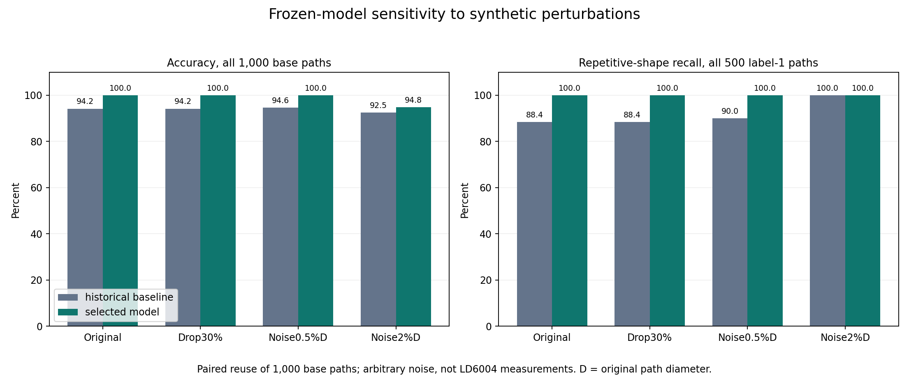

# Frozen-model synthetic sensitivity audit

This post-freeze audit did not train or tune either model. Each row reuses the same 1,000 original paths.
Perturbed inputs keep their underlying generator label. Settings are arbitrary stress levels, not measured LD6004 noise.

| Condition | Model | Coverage | Accuracy / all paths | Label 0 recall | Label 1 recall | Abstentions |
|---|---|---:|---:|---:|---:|---:|
| Original | historical_baseline | 100.0% | 94.2% | 100.0% | 88.4% | 0 |
| Original | selected_model | 100.0% | 100.0% | 100.0% | 100.0% | 0 |
| Drop 30% interior | historical_baseline | 100.0% | 94.2% | 100.0% | 88.4% | 0 |
| Drop 30% interior | selected_model | 100.0% | 100.0% | 100.0% | 100.0% | 0 |
| Gaussian 0.5% D | historical_baseline | 100.0% | 94.6% | 99.2% | 90.0% | 0 |
| Gaussian 0.5% D | selected_model | 100.0% | 100.0% | 100.0% | 100.0% | 0 |
| Gaussian 2% D | historical_baseline | 100.0% | 92.5% | 85.0% | 100.0% | 0 |
| Gaussian 2% D | selected_model | 100.0% | 94.8% | 89.6% | 100.0% | 0 |

Accuracy counts abstentions as unsuccessful; per-class recall retains them in the denominator.
Rows are paired conditions, not independent additional samples. No clinical or actual radar accuracy follows from this audit.
Five selected-model scores per condition matched the portable JSON evaluator within 1e-12.
Frozen models and original test-file hashes are unchanged. Full per-path/family results are in robustness.json.

