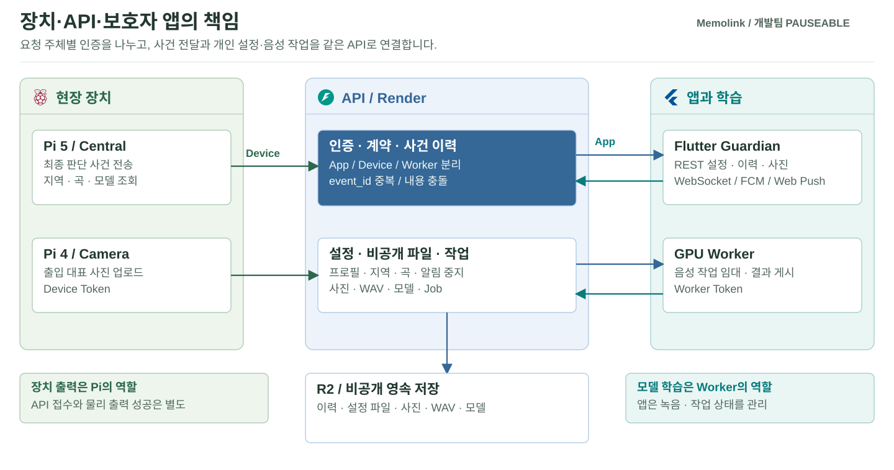
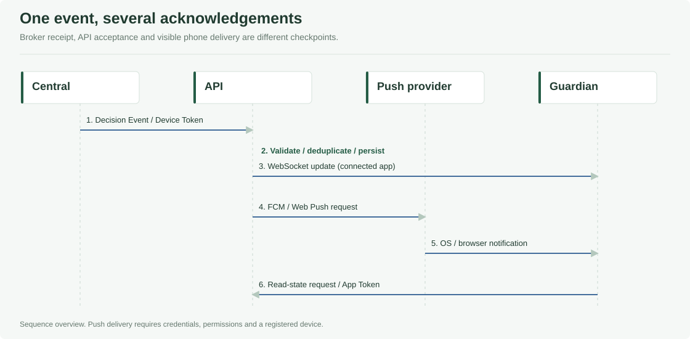

# 보호자 앱과 API 서버

Memolink의 보호자 화면과 서버를 관리합니다. **Flutter 앱은 상황 확인과 설정 입력**, **FastAPI는 인증·이력·파일·실시간 전달**을 담당합니다. 행동 분석·가전 실행은 Pi, 음성 모델 학습은 GPU Worker의 역할입니다.

[전체 프로젝트](../README.md) · [통신 규격](../Pauseable.contracts/README.md) · [장치 실행](../Pauseable.edge/README.md)

| 범주 | 소스 | 주요 내용 |
| --- | --- | --- |
| [API 서버](#api-구현-상세) | `api/` | 장치 사건, 사진, 설정, 음성 작업, 인증·저장 |
| [보호자 앱](#보호자-앱-상세) | `guardian/` | 알림·사진·프로필·지역·선호 음악·녹음 |
| [알림 전달](#알림-수신과-일시-중지) | API + 앱 | WebSocket, FCM/Web Push, 반복행동 알림 중지 |
| [개발·검증](#개발환경과-실행) | 테스트·도구·CI | 로컬/Render 실행, Android, 검증 기록 |



## API 구현 상세

### API 기능

[main.py](api/app/main.py)가 요청 경로를 연결하고 [security.py](api/app/security.py)가 요청 주체를 검사합니다.

| 기능 | 대표 경로·처리 |
| --- | --- |
| Central 결정 | `POST /api/events/decisions` · 계약·UTC·ID·actions 검사 |
| 이력·읽음 | 대상자별 dashboard·alerts 조회와 읽음 갱신 |
| 출입 사진 | 장치 업로드 → 비공개 저장 → 인증된 이미지 조회 |
| 개인 설정 | care-profile·home-environment·favorite-songs |
| 알림 설정 | 기기 등록·Push·반복행동 알림 중지 만료 시각 |
| 음성 학습 | 동의·녹음 세트·clip·Job 임대·갱신·모델 게시/설치 확인 |

### 인증과 저장

| 요청 주체 | 인증값 | 담당 요청 |
| --- | --- | --- |
| 보호자 앱 | `PAUSEABLE_APP_TOKEN` | 이력·사진·설정·동의·녹음 |
| Pi 장치 | `PAUSEABLE_DEVICE_TOKEN` | 사건·사진 전송, 지역·곡·모델 조회 |
| GPU Worker | `PAUSEABLE_WORKER_TOKEN` | 작업 임대·처리·결과 게시 |

운영 모드 `PAUSEABLE_ENV=production`에서는 미설정 토큰 요청을 차단합니다. `STORAGE_BACKEND=local`은 로컬 파일, `r2`는 영속 저장소를 사용합니다. 운영 서버에는 HTTPS와 역할별 토큰을 준비합니다. 현재 팀 시험용 공유 App Token은 사용자별 로그인·대상자 접근권한 분리를 대신하지 않습니다.

### 사건 접수와 중복 처리

Central의 Device 인증과 계약을 검사한 뒤 사건을 저장합니다. 같은 `event_id`·같은 내용은 재전송으로 처리하고, 같은 ID의 다른 내용은 충돌로 구분합니다. `Idempotency-Key`가 있으면 본문의 ID와 같아야 합니다. **서버 접수, 이력 저장, Push 요청, 실제 휴대폰 표시는 다른 완료 상태**입니다.

## 보호자 앱 상세

담당: **권태준 ([ktj-oss](https://github.com/ktj-oss))**. Flutter 화면·상태 관리, API·실시간 알림·녹음·설정 연동을 구현했습니다. 주 시험 환경은 노트북 웹과 Android이며 iOS 실기 빌드·푸시는 검증하지 않았습니다.

### 화면별 기능

| 범주 | 구현 | 연결되는 처리 |
| --- | --- | --- |
| 상황 확인 | 홈·알림·기록, 연결 오류·재시도 | API 이력·WebSocket |
| 출입 사진 | 인증된 이미지 바이트 조회·확대·재시도 | Pi 4 촬영·업로드가 선행 |
| 프로필 | 이름·가족관계·TTS 호칭 `patient_call_name` | Pi가 안내 문장에 적용 |
| 지역 | 최초 선택·변경, 지역 코드·기상청 격자 | [별도 조명 모듈](../Pauseable.integrations/README.md)에서 조회 |
| 선호 음악 | 제목·YouTube 링크 추가/삭제, 중복·형식 검사, 최대 30곡 | [Pi 음악 모듈](../Pauseable.edge/README.md#선호-음악-설치와-시험)이 조회·재생 요청 |
| 음성 | 동의·고정 대본·WAV 업로드·재전송·학습 상태·새 세트 | GPU 학습 → Pi 모델 교체 |
| 알림·화면 설정 | 안전 알림·알림음, 반복행동 알림 중지, 실행 중 테마 | 서버 알림 정책과 앱 상태 |

현재 테마는 앱 실행 상태이며 영구 저장 기능으로 설명하지 않습니다. 지역은 거주지역 설정이지 GPS 추적·상세 주소·날씨 화면이 아닙니다. 앱의 조명 설정 저장과 장치 타이머의 시작·중지는 직접 연결돼 있지 않습니다.

### 구현 및 검증 범위

실제 API 연결과 데모 표시는 구분합니다. 기본 `main.dart`는 API Repository를 사용하며 인증 실패 때 Mock으로 전환하지 않습니다. 홈에는 미확인 위치·활동·안전·오늘 상태·마지막 연결·기기 정상 연결 문구와 상태 데모 배너를 표시하지 않습니다. 저장된 대상자 이름과 실제 **앱–알림 서버 연결 상태**는 유지하며, 이 연결을 환자나 Pi·센서의 상태로 해석하지 않습니다.

가상 기기 연결 상태와 고정 시연 센서 이력은 설정·기록 화면에서 표시하지 않고, 앱에서 가상 기기 연결 조회·재확인도 호출하지 않습니다. 기록 탭은 출입 사진과 촬영 시각을 유지하며 저장된 장면이 없으면 빈 상태를 안내합니다. 실제 센서 이력의 수집 기능을 새로 구현했다는 뜻은 아닙니다. 기본 알림·사진 샘플과 설정의 데모 상황 시뮬레이터는 여전히 남아 있으므로 실장비 기록과 구분합니다.

사진의 기존 `source=mock_camera` 또는 `asset://` 표시는 샘플로 안내합니다. 실제 카메라 출처(`pi4_camera`)와 출처 정보가 없는 이전 API 사진에는 샘플 촬영 문구를 붙이지 않습니다. 이 구분은 표시용이며 비공개 이미지의 인증·조회·확대·재시도 경로는 변경하지 않습니다.

실제 전화·문자·긴급기관 연결이 구현되지 않은 **전화 걸기·SOS 긴급 연락 버튼과 빠른 실행 구역은 앱에서 표시하지 않습니다**. 기존 가상 요청 API는 이전 버전 호환을 위해 유지하지만 현재 화면에서는 호출하지 않습니다. 사진은 앱이 촬영하지 않으며 실제 카메라 업로드가 있어야 표시됩니다. 누락된 횟수를 임의 숫자로 채우지 않고 감지 내용·시각 중심으로 표시합니다.

## 알림 수신과 일시 중지



### 전달 경로

| 경로 | 사용하는 상황 | 확인 사항 |
| --- | --- | --- |
| REST | 이력·설정·사진 조회 | App Bearer와 대상자 일치 |
| WebSocket | 열린 앱의 실시간 갱신 | 일회용 ticket, 연결·재연결 |
| FCM | Android 시스템 알림 | Firebase 설정·기기 등록·권한 |
| Web Push | 브라우저 시스템 알림 | 구독·서비스워커·OS/브라우저 권한 |

앱은 `POST /api/patients/{patient_id}/alert-websocket-ticket`으로 ticket을 받은 뒤 `/ws/alerts`에 연결합니다. 장기 App Token을 WebSocket 주소에 넣는 방식이 아닙니다. 알림 선택 후 앱 이동과 읽음 처리를 지원하지만 읽음이 현장 조치 완료를 뜻하지는 않습니다.

### 반복행동 알림 일시 중지

정상 상황을 확인한 보호자가 **30분·1시간·3시간·24시간**을 선택합니다. 서버는 만료 시각을 저장하고 앱은 이를 복원합니다. 만료 또는 수동 재개 시 새 알림부터 다시 전달합니다.

| 구분 | 중지 중 동작 |
| --- | --- |
| 반복행동 WebSocket·Web Push·FCM | 전달 중지 |
| 반복행동 이력 저장 | 계속 저장, 재개 시 지난 알림 재발송 없음 |
| 배회·출입 사진 | 유지 |
| Pi 감지·TTS·가전 | 유지 |
| 저장 실패 | 완료로 표시하지 않음 |
| 저장소 조회 장애 | 알림을 계속 전달 |
| 이미 전송 중/도착한 알림 | 취소하지 않음 |

경로는 `GET/POST/DELETE /api/patients/{patient_id}/repetitive-alert-pause`입니다. R2에서는 `patients/{patient_id}/repetitive-alert-pause.json`에 저장합니다. 기존 APK에도 서버의 중지는 적용되지만 새 상태 표시·복원에는 최신 웹/APK가 필요합니다.

## 음성 녹음과 동의

[동의 화면](guardian/lib/screens/voice_recording_consent_sheet.dart)에서 동의 버전과 서버 영수증을 확인한 뒤 녹음을 엽니다. 거부·저장 실패는 녹음/업로드만 막고 기존 알림·사진 확인은 유지합니다.

| 항목 | 현재 처리 |
| --- | --- |
| 대본 | 160문장, 총 800초는 권장 분량이지 상한이 아님 |
| 녹음 | 문장당 최대 45초, PCM16·16 kHz·mono WAV |
| 업로드 | 문장 종료 후 전송, 열린 화면에서 실패 clip 재전송 |
| 화면 종료 | 실패 녹음의 영구 복구 기능 없음 |
| 새 학습 | 완료 세트 확인 후 새 세트 생성, 문장 1번부터 수집 |
| 모델 적용 | [Voice 전처리·학습](../Pauseable.ai/README.md#voice-학습과-운영-상세), Pi 검증·교체는 별도 |
| 보관·삭제 | 정책 안내와 실제 삭제 실행은 별개. 전체 삭제·동의 철회 UI 미구현 |

## 개발환경과 실행

### API 로컬 실행

Python 3.12 별도 가상환경을 사용합니다. 저장소 루트 기준입니다.

```sh
cd Pauseable.apps/api
python -m venv .venv
```

운영체제에 맞는 한 가지 설정을 사용합니다.

```sh
# Linux / macOS
. .venv/bin/activate
export PAUSEABLE_ENV=development
export STORAGE_BACKEND=local
export PAUSEABLE_APP_TOKEN=LOCAL_DEVELOPMENT_ONLY
```

```powershell
# Windows PowerShell
.\.venv\Scripts\Activate.ps1
$env:PAUSEABLE_ENV = "development"
$env:STORAGE_BACKEND = "local"
$env:PAUSEABLE_APP_TOKEN = "LOCAL_DEVELOPMENT_ONLY"
```

```sh
python -m pip install -r requirements.txt
python -m unittest discover -s tests -t . -p "test_*.py"
python -m uvicorn app.main:app --host 127.0.0.1 --port 8000
```

`/health`에서 상태, `http://127.0.0.1:8000/docs`에서 API를 확인합니다. 실운영 토큰을 예시 값으로 덮어쓰지 않습니다.

### Flutter 로컬 실행

Flutter 3.47.6, Dart `^3.13.0` 기준입니다. 새 터미널에서 저장소 루트 기준으로 시작합니다.

```sh
cd Pauseable.apps/guardian
flutter pub get
flutter analyze
flutter test
flutter run -d chrome --web-port=18109 --dart-define=API_BASE_URL=http://127.0.0.1:8000 --dart-define=APP_TOKEN=LOCAL_DEVELOPMENT_ONLY
```

[api_config.dart](guardian/lib/config/api_config.dart)는 `API_BASE_URL`·`PATIENT_ID`·`APP_TOKEN`을 빌드 설정으로 읽습니다. 다른 대상자는 서버와 같은 ID를 지정합니다. Token이 비어 있으면 요청을 차단합니다.

<details>
<summary><strong>실제 Render 서버 연결 미리보기</strong></summary>

앱 폴더에서 별도 Python 3.12 가상환경과 API 의존성을 준비합니다.

```powershell
python -m venv .venv
.\.venv\Scripts\python.exe -m pip install -r ../api/requirements.txt
```

비공개 `render-web.secrets.json` 형식:

```json
{
  "API_BASE_URL": "https://pauseable-api.onrender.com",
  "PATIENT_ID": "SET_PATIENT_ID_FROM_CONFIG",
  "APP_TOKEN": "REPLACE_WITH_APP_TOKEN_LOCALLY"
}
```

```powershell
.\.venv\Scripts\python.exe -m tools.serve_render_web --build
```

`http://127.0.0.1:18108/`에서 확인합니다. 실제 Token은 로컬 Python 중계에서 읽고 웹 빌드에는 별도 로컬 접속값을 넣습니다. 서버 종료 시 접속할 수 없으며 코드·포트·대상자 변경 시 다시 빌드합니다. 실제 Render의 저장·삭제·업로드를 변경하는 시험입니다. 외부 IP나 공개 터널로 중계를 노출하지 않습니다. [상세 설정](guardian/docs/RENDER_WEB_PREVIEW_KO.md)

</details>

### Android Push 확인

JDK 17·Android SDK 36과 [Firebase 설정](guardian/docs/ANDROID_PUSH_SETUP_KO.md)을 준비합니다. 앱 폴더에서 비공개 `android-test.secrets.json`을 사용합니다.

```sh
flutter build apk --release --dart-define-from-file=android-test.secrets.json
```

산출물은 `build/app/outputs/flutter-apk/app-release.apk`입니다. [수동 APK 빌드](../.github/CI_README.md#android-시험-apk)도 제공합니다. 시험용 서명과 공유 App Token은 공개 배포용 로그인·서명 관리를 대신하지 않습니다. 실제 APK에서 foreground·background·잠금 상태의 수신·표시·앱 이동을 확인합니다.

### 주요 코드

| 범주 | 파일·경로 |
| --- | --- |
| 앱 구성 | [main.dart](guardian/lib/main.dart), [app.dart](guardian/lib/app.dart) |
| 데이터 계약·API | [repositories](guardian/lib/repositories), [models](guardian/lib/models) |
| 인증·연결·Push·녹음 | [services](guardian/lib/services) |
| 홈·사진·설정·음성 화면 | [screens](guardian/lib/screens) |
| 대본·지역 목록 | [assets](guardian/assets) |
| 앱 검사·로컬 도구 | [test](guardian/test), [tools](guardian/tools), [web](guardian/web) |
| API·인증·저장·알림 서비스 | [app](api/app), [tests](api/tests) |

`GuardianRepository`는 화면과 데이터 접근을 분리합니다. 인증 HTTP는 설정된 API 출처를 벗어나거나 인증값을 동반한 리다이렉트를 허용하지 않습니다. 장치의 선호곡 무작위 조회는 Device API이며 앱이 직접 호출하지 않습니다.

## 검증 기록과 실기 확인

### 자동 검사와 팀 실기 기록

아래는 음악 연동 commit [d2b49a8](https://github.com/RACOS-Team/Pauseable/commit/d2b49a8a32beeb5fca4e61e0be0a20a7f60fc27b)·[PR #1](https://github.com/RACOS-Team/Pauseable/pull/1)의 기록입니다. 이후 모든 변경을 같은 수로 재시험했다는 뜻은 아닙니다.

| 자동 검사 | 해당 버전 기록 |
| --- | --- |
| Flutter 정적 분석·테스트 | analyze 문제 없음, 85개 통과 |
| API 회귀 | 158개 통과 |
| 웹 Push 서비스워커 | Node 테스트 6개 통과 |
| release 빌드 | Actions 웹·Android APK 성공 |

이후 홈 상태 표시를 정리한 [dae8b91](https://github.com/RACOS-Team/Pauseable/commit/dae8b9199c18d834c9f4168b5a20707d2c4c413f)의 팀 검사 기록은 Flutter 91개·API 166개·웹 서비스워커 6개 통과입니다. 위 표와 대상 버전이 다르며, 여기서 최신 APK의 모든 실기 상태를 재검증했다는 뜻은 아닙니다.

| 실제 서버·팀 시험 기록 | 범위 |
| --- | --- |
| Render 웹 연결 | 선호곡 저장 후 API 재조회 `200` |
| 음성 동의 | Render 저장 확인 |
| Chrome 웹 Push | 탭을 닫은 상태 표시·선택 후 앱 연결. Chrome 완전 종료·모든 OS 보장 아님 |
| 배회·야간 현관 사진 | 팀원의 휴대폰 실장비 시연 성공 보고. 최신 APK 전체 재검증과 구분 |

다음 항목은 설치 버전별로 확인합니다: 새 선호곡의 Pi 실제 재생, 새 음성 세트의 학습→게시→교체→합성, 앱 지역에 맞는 조명 반응, Android 권한·잠금·절전 상태. iOS 네이티브 Push는 현재 검증 범위가 아닙니다.

<details>
<summary><strong>검사 재현</strong></summary>

앱 폴더:

```sh
flutter analyze
flutter test
node --test test/web_push_service_worker.test.cjs
```

API 폴더:

```sh
python -m unittest discover -s tests -t . -p "test_*.py"
```

모의 API·임시 저장소를 쓰는 검사와 실장비 시험을 구분합니다. [자동 검사](../.github/workflows/native-alert-checks.yml) · [실기 알림 확인](guardian/docs/REAL_DEVICE_ALERT_VERIFICATION.md)

</details>

### 문제 해결

| 증상 | 확인할 것 |
| --- | --- |
| `18108` 접속 거부 | 같은 노트북의 중계 서버 실행 여부 |
| API `401/403` | App Token 누락·불일치·역할 혼용 |
| API `404` | 서버 버전·경로·대상자 ID |
| 사진 표시 실패 | 실제 업로드, 인증된 이미지 조회 응답 |
| 열린 앱만 수신 | 별도 Push 구독·Firebase·OS 권한 |
| 노래 저장 후 무음 | Pi 설치·대상자·cooldown·Player 로그 |
| 녹음/전송 실패 | 동의 영수증·마이크·세트 상태·서버 연결 |

## 개인정보와 운영 설정

`*.secrets.json`·`.env`·`android/app/google-services.json`은 Git 제외 대상입니다. Device/Worker Token·R2 키·VAPID 개인키·Firebase 서비스 계정을 앱에 넣지 않습니다. 웹에 실제 공유 Token을 직접 빌드하면 JavaScript에서 노출될 수 있으며 APK도 추출 가능성을 전제로 팀 내부에만 전달합니다.

[음성 보관·삭제 정책](../Pauseable.docs/voice/DATA_AND_ARTIFACTS_KO.md) · [지역 연동](../Pauseable.docs/integrations/home-assistant/RENDER_REGION_SETUP_KO.md) · [음악 설치](../Pauseable.edge/README.md#선호-음악-설치와-시험)

서버 배포·APK 설치·Pi 적용은 별도로 관리하고, 실기 증거에는 버전과 같은 `event_id`의 접수·저장·표시를 남깁니다.
