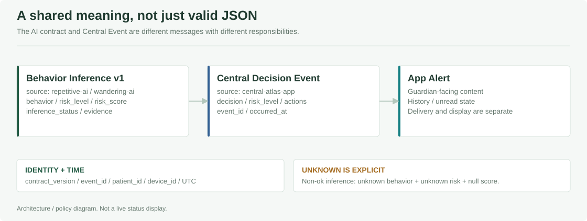
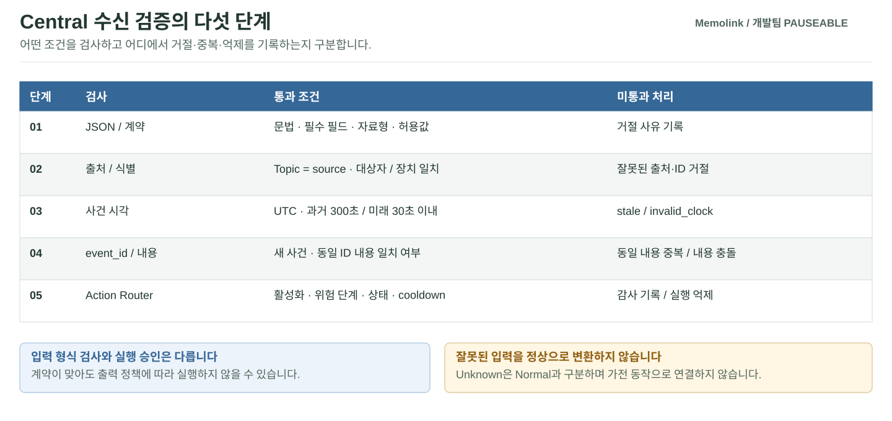

# PAUSEABLE / Contracts

**AI의 추론, Central의 실행 결정, 앱의 알림을 서로 구분하는 공통 약속입니다.** JSON Schema는 필드·형식·허용값을 정의하고, 각 서비스는 그 계약과 실행 정책을 검증합니다. 이 폴더 자체가 메시지를 구독하거나 변환하는 서비스는 아닙니다.

[전체 프로젝트](../README.md) · [AI](../Pauseable.ai/README.md) · [Central](../Pauseable.edge/README.md) · [API·앱](../Pauseable.apps/README.md)

## 계약 지도



같은 사건을 이어받더라도 세 메시지의 책임은 다릅니다. AI가 `risk`를 보냈다는 사실과 Central이 가전 동작을 허용했다는 사실을 하나로 취급하지 않습니다.

<details>
<summary><strong>연결별 Schema 파일 전체 보기</strong></summary>

| 연결 | 기준 파일 | 메시지 의미 |
| --- | --- | --- |
| 반복행동·배회 AI → Central | [`communication-v1/schemas/behavior-inference.schema.json`](communication-v1/schemas/behavior-inference.schema.json) | AI 판단 상태·점수·관측 근거 |
| Central → API | [`communication-v1/schemas/decision-event.schema.json`](communication-v1/schemas/decision-event.schema.json) | 최종 Decision과 허용된 actions |
| API → 앱 | [`communication-v1/schemas/app-alert.schema.json`](communication-v1/schemas/app-alert.schema.json) | 보호자에게 보여줄 알림 |
| 보호자 응답 | [`guardian-response.schema.json`](communication-v1/schemas/guardian-response.schema.json) | 보호자 응답 형식 |
| 장치 명령·응답 | [`device-command.schema.json`](communication-v1/schemas/device-command.schema.json), [`command-ack.schema.json`](communication-v1/schemas/command-ack.schema.json) | 명령·ACK 형식 |
| 센서 → 수신기 | [`mmwave-target-event.schema.json`](mmwave-target-event.schema.json) | 센서 대상·위치·시각 등 입력 |
| HA → 연동 계층 | [`ha-entity-event.schema.json`](ha-entity-event.schema.json) | 엔티티 상태 이벤트 |
| 음성 요청·결과 | [`voice-request.schema.json`](voice-request.schema.json), [`voice-result.schema.json`](voice-result.schema.json) | 음성 관련 교환 형식 |

</details>

스키마 파일이 있다는 사실만으로 해당 생산자·소비자의 배포와 실기 연결이 완료된 것은 아닙니다. 실행 중인 구현도 함께 확인합니다.

## 검증을 통과하는 순서



| 입력 사례 | 처리 원칙 |
| --- | --- |
| 반복행동 Topic에 배회 `source` | 출처 불일치로 거절 |
| 오래된 사건·허용 범위 밖의 미래 시각 | 로그를 남기고 실행에 전달하지 않음 |
| 동일 ID·동일 내용 | 중복으로 처리 |
| 동일 ID·다른 내용 | 충돌로 구분 |
| 관측 부족·센서/모델 오류 | `unknown`으로 구분, 정상이나 자동 가전 동작으로 바꾸지 않음 |

## AI → Central: 추론 전달

| MQTT Topic | `source` | 허용 행동 범위 |
| --- | --- | --- |
| `pauseable/ai/repetitive/decision` | `repetitive-ai` | `normal`, `repetitive`, `unknown` |
| `pauseable/ai/wandering/decision` | `wandering-ai` | `normal`, `wandering`, `unknown` |

<details>
<summary><strong>주요 필드와 식별 규칙</strong></summary>

| 필드 | 목적 |
| --- | --- |
| `contract_version` | 현재 v1 계약은 `1.0` |
| `event_id` | 사건 식별과 중복·내용 충돌 확인 |
| `occurred_at` | UTC 사건 시각, 타임존을 명시 |
| `patient_id`, `device_id` | 대상자·장치 일치 확인 |
| `source`, `behavior` | Topic·출처·행동의 의미 일치 |
| `risk_level`, `risk_score` | 위험 단계와 시스템 점수 |
| `inference_status` | 정상 추론·관측 부족·센서/모델 오류 구분 |
| `evidence` | 관측 개수·시간 범위·패턴·판단 근거 |

`inference_status=ok`이면 행동·위험도·정수 점수가 해당 계약을 따라야 합니다. 관측 부족이나 오류이면 행동과 위험도는 `unknown`, 점수는 `null`로 표현합니다. `risk_score`는 0~100의 시스템 점수이지 치매 확률이나 정확도가 아닙니다.

현재 v1 스키마에는 **시연 대상자·장치 ID를 고정한 제약**이 있습니다. 다른 가구로 배포할 때 producer·Central 설정·스키마·API의 식별 규칙을 함께 검토해야 하며, README의 예시 ID만 바꾸면 다중 사용자 지원이 완성되는 것은 아닙니다.

</details>

## Central → API: 실행 결정 전달

Central은 AI 메시지를 그대로 전달하지 않고 내부 Decision과 실행 정책을 반영해 `POST /api/events/decisions`로 보냅니다.

- `source`는 `central-atlas-app`입니다.
- `decision`은 `normal`, `repetitive_behavior`, `wandering_suspected`, `unknown`을 구분합니다.
- v1 최종 Event의 `actions`에는 `notify_guardian`, `control_appliance`가 정의되어 있습니다.
- Device Token으로 인증하고 `event_id`를 기준으로 중복을 처리합니다.
- API의 `Idempotency-Key`와 본문의 `event_id`가 다르면 거절합니다.
- 동일 ID에 다른 내용이 들어오는 충돌과 동일 메시지 재전송을 구분합니다.

## 어디서 검증하는가

| 단계 | 구현 | 검증 범위 |
| --- | --- | --- |
| Central 입력 | [`BehaviorInference.cpp`](../Pauseable.edge/central/core/src/BehaviorInference.cpp) | JSON 필드·출처·Topic·시각·ID·중복 |
| Central 실행 | [`ActionRouter.cpp`](../Pauseable.edge/central/core/src/ActionRouter.cpp) | 행동별 활성화·위험도·cooldown·실행 허용 |
| API 수신 | [`main.py`](../Pauseable.apps/api/app/main.py) | 인증·요청 모델·UTC·actions·이벤트 충돌 |

JSON 문법 검사, JSON Schema 적합성 검사, 서비스의 실행 정책 검사는 서로 다른 단계입니다. JSON이 아닌 입력을 임의로 정상 메시지로 바꾸어 실행하는 계약은 아닙니다.

## 버전과 변경 시 주의

최상위의 [`decision-event.schema.json`](decision-event.schema.json) 같은 간략 계약과 `communication-v1` 계약은 필드와 허용값이 다릅니다. **파일 이름만 보고 서로 교체하지 않습니다.** HA 배포 폴더의 계약 사본도 공유 계약과 일치하는지 확인합니다.

1. 생산자·소비자·Topic·인증·버전을 먼저 정합니다.
2. 정상·unknown·누락 필드·범위 초과·동일 ID 충돌 사례를 함께 확인합니다.
3. JSON Schema와 C++/Python 검증기의 의미가 일치하는지 테스트합니다.
4. 배포 사본·환경 설정을 함께 맞추고 이전 메시지와의 호환 여부를 기록합니다.

예를 들어 아래 명령은 **JSON 문법만 확인**합니다. 의미 검증이나 E2E 시험을 대신하지 않습니다. 저장소 루트에서 실행합니다.

```sh
python -m json.tool Pauseable.contracts/communication-v1/schemas/behavior-inference.schema.json
```

[`ALIGNMENT_REVIEW.md`](communication-v1/ALIGNMENT_REVIEW.md)는 과거 대조 기록입니다. 미구현 여부는 당시 문장만 복사하지 말고 현재 실행 코드와 대조합니다.
