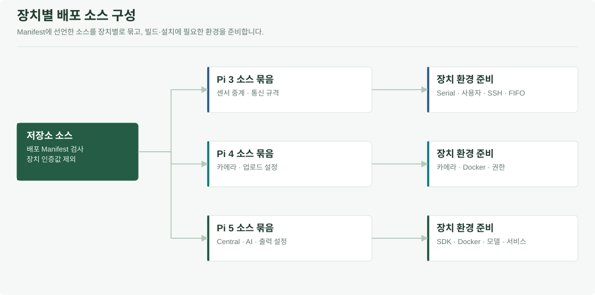
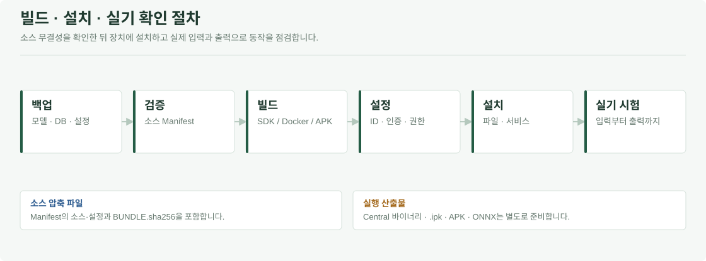

# Memolink / Deploy

Pi 3·Pi 4·Pi 5의 배포 소스, systemd 설정과 기존 설치의 이름 변경 정보를 관리합니다. 장치별 소스 묶음을 생성한 뒤, 대상 환경에서 빌드·설정·설치·실기 시험을 진행합니다.

[전체 프로젝트](../README.md) · [Edge 구성](../Pauseable.edge/README.md) · [전체 배포 인계](../Pauseable.docs/DEPLOYMENT_HANDOFF.txt)



## 장치별 배포 구성

| 경로 | 대상 | 내용 |
| --- | --- | --- |
| [`mmwave-autostart`](mmwave-autostart) | Pi 3/4/5 | 배포 입력 manifest·기기별 소스 묶음 생성 |
| [`mmwave-autostart/pi3`](mmwave-autostart/pi3) | Pi 3 | 릴레이 설치기·서비스 |
| [`mmwave-autostart/pi5`](mmwave-autostart/pi5) | Pi 5 | mmWave Dockerfile·Publisher 환경·FIFO·서비스 |
| [`pi5/systemd`](pi5/systemd) | Pi 5 | 앱·로컬 Gateway·웹·터널 관련 unit |
| [`gpu/voice-worker`](gpu/voice-worker) | GPU Worker | 음성 학습 Worker 서비스 |
| [`migration`](migration) | 기존 설치 | 이전 이름·경로·서비스·설정 대응표 |

HA 서비스는 [`Pauseable.ai/ha/deploy`](../Pauseable.ai/ha/deploy), 개별 출력·음성 모델 교체 서비스는 [`Pauseable.edge`](../Pauseable.edge/README.md)에 있습니다. 각 장치에 필요한 설정과 산출물을 함께 준비합니다.

## 배포 순서



`tar.gz`는 소스와 설정을 전달하는 압축 파일입니다. Central 앱의 `.ipk`, Android APK와 개인화 ONNX는 각 빌드·학습 절차에서 별도로 생성합니다.

## 배포 준비 상태

2026-10-28 소스 Manifest 검사에서 다음 파일의 체크섬 불일치로 검사가 중단됐습니다.

```text
Source checksum mismatch:
Pauseable.ai/ha/deploy/pauseable-washer-youtube-tts.service
```

현재 서비스 파일과 [`FILES.sha256`](mmwave-autostart/FILES.sha256)의 배포 목록을 대조하고, 변경 파일의 포함 여부와 내용을 확인한 뒤 Manifest를 갱신해야 합니다. 소스 검증이 완료되기 전까지 장치별 묶음은 배포 승인된 산출물로 취급하지 않습니다.

## 기기별 소스 묶음

<details>
<summary><strong>소스 검증·묶음 생성·압축 해제 후 무결성 확인</strong></summary>

Python 3.12로 **저장소 루트에서** 실행합니다.

```sh
python Pauseable.deploy/mmwave-autostart/package_devices.py --verify-source-manifest
python Pauseable.deploy/mmwave-autostart/package_devices.py --output deployment-bundles
```

| 산출물 | 포함 대상 |
| --- | --- |
| `pauseable-pi3.tar.gz` | 센서 릴레이·관련 계약·설치 설정 |
| `pauseable-pi4.tar.gz` | 카메라·배포 인계·이전 설정 자료 |
| `pauseable-pi5.tar.gz` | Central·AI·음성·연동·Pi 5 실행 설정 중 manifest에 선언된 입력 |

각 묶음에는 `BUNDLE.sha256`이 있습니다. 압축을 푼 최상위 폴더에서 확인합니다.

```sh
sha256sum -c BUNDLE.sha256
```

</details>

묶음에는 Manifest에 선언된 소스·설정과 `BUNDLE.sha256`이 들어갑니다. Central 바이너리·`.ipk`·APK·개인화 ONNX·원본 녹음·실제 Token은 포함하지 않습니다. 설치 후에는 각 서비스의 입력과 출력을 확인합니다.

## 장치별 준비

| 장치 | 설치 전 확인 | 설치 후 확인 |
| --- | --- | --- |
| Pi 3 | 사용자·serial/dialout 권한·Pi 5 주소·SSH | 센서 입력·중계·끊김 복구 |
| Pi 4 | 카메라·Docker·트리거/Device 인증 | 이벤트 전후 사진·업로드·앱 조회 |
| Pi 5 | Atlas SDK 산출물·Docker·FIFO·모델·환경 파일 | Central·AI·TTS·가전·API 연동 |
| GPU Worker | NVIDIA Driver·Docker GPU·Worker 인증 | dry-run·Job 임대·학습·게시 |
| API·앱 | Root Directory·R2/FCM·빌드 설정 | 인증·이력·Push·설치한 APK |

Pi 3 설치기의 `--check`는 파일 구성을 확인하고, `--apply`는 실제 설치를 수행합니다. 설치만으로 서비스를 자동 시작하지 않습니다. 전체 절차는 [배포 인계](../Pauseable.docs/DEPLOYMENT_HANDOFF.txt)를 따릅니다.

## 기존 장치에서 이름 이전

[`legacy-to-pauseable.json`](migration/legacy-to-pauseable.json)을 기준으로 다음을 함께 확인합니다.

- MQTT Topic, 환경변수, 앱·가상 기기 ID
- systemd unit, 컨테이너·이미지 태그, 실행 파일 경로
- 모델·DB의 출처·특징 규격·읽기/쓰기 권한
- 장치별 사용자·그룹·SSH·네트워크 설정

이전 `/data`·`/var/lib` 전체를 덮어쓰거나 기존 개인 이력을 삭제하지 않습니다. 경로 이름 변경과 DB·모델 호환성 확인은 별개입니다. ATLAS 읽기 전용 루트나 장치 보안 설정을 설치 편의를 위해 임의로 완화하지 않습니다.

## 완료 기준

1. 코드·모델·설정 버전과 적용한 장치를 기록합니다.
2. 서비스 시작과 실제 입력 수신을 구분해 확인합니다.
3. Central이 허용한 출력만 동작하는지 확인합니다.
4. 같은 사건 ID로 API 저장·TTS·가전·사진·앱 표시를 대조합니다.
5. 중복·재연결·재시작·실패 시 기존 모델 유지와 복구를 시험합니다.

배포 기록에는 소스·모델 버전, 대상 장치와 시험 결과를 남깁니다. Token·presigned URL·개인 이력·사진은 공유 로그에서 제외합니다.
