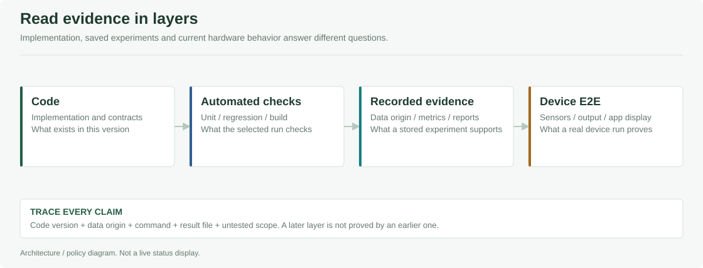

# 설계·데이터 근거·평가·운영 자료

시스템 설계, AI 평가, 보고서와 장치 운영 자료를 모았습니다. 구현 설명은 영역별 README에서, 실험의 입력·조건·결과는 아래 평가 파일에서 확인할 수 있습니다.

| 확인하려는 내용 | 시작할 곳 |
| --- | --- |
|  어떤 시스템인가? | [프로젝트 소개와 동작 사례](../README.md#프로젝트-소개) |
|  어떤 환경에서 만드는가? | [개발환경](DEVELOPMENT_ENVIRONMENT_KO.md) |
|  기능이 어느 파일에 있는가? | [기능별 코드 위치](SOURCE_MAP_KO.md) |
|  무엇을 시험했고 결과가 어떤가? | [평가 자료](#평가-자료-읽기) |
|  어떻게 설치하고 확인하는가? | [배포 안내](../Pauseable.deploy/README.md), [실기 기록](#실기-시험과-운영-기록) |

[전체 프로젝트](../README.md) · [AI](../Pauseable.ai/README.md) · [Apps](../Pauseable.apps/README.md) · [Edge](../Pauseable.edge/README.md) · [Deploy](../Pauseable.deploy/README.md)

[개발환경](DEVELOPMENT_ENVIRONMENT_KO.md) · [기능별 코드 위치](SOURCE_MAP_KO.md) · [평가 자료](#평가-자료-읽기) · [보고서](#보고서와-시각-자료) · [운영 기록](#실기-시험과-운영-기록)



## 주요 문서

문서는 **설계 → 데이터 근거 → 평가 결과 → 보고서 → 운영 기록**으로 읽습니다. 기능 설명을 찾는 경우 해당 상위 README로, 수치의 출처를 확인하는 경우 원본 평가 파일로 이동합니다.

| 내용 | 자료 |
| --- | --- |
| 시스템 목적·아키텍처·소스 구성 | [프로젝트 README](../README.md) |
| 장치·Runtime·의존성·빌드 도구 | [개발환경](DEVELOPMENT_ENVIRONMENT_KO.md) |
| Subscribe·Action Router 등 기능별 구현 파일 | [기능별 코드 위치](SOURCE_MAP_KO.md) |
| 가전 이벤트 수집·특징·학습 | [AI 구성](../Pauseable.ai/README.md), [실시간 수집](ha/ha_realtime_collection_guide.md) |
| Baseline·IF·AE 및 개인화 | [현재 HA 모듈 운용](../Pauseable.ai/README.md#baseline과-개인화-모델), [Baseline 검증 절차](ha/ha_baseline_validation_protocol.md) |
| 데이터 확보와 문헌 기반 시나리오 | [공개 데이터 검토](ha/public_power_data_guide.md), [문헌 조사](ha/EVIDENCE_RESEARCH_20261005_KO.md) |
| mmWave 판단 상태와 경로 평가 | [Runtime](mmwave/RUNTIME.md), [형태 모델 실험 설계](../Pauseable.ai/mmwave/src/shape_v2/PROTOCOL.md) |
| MQTT·JSON·Central 실행 정책 | [통신 규격](../Pauseable.contracts/README.md), [장치 실행](../Pauseable.edge/README.md) |
| 보호자 앱 기능·시험 결과 | [보호자 앱 README](../Pauseable.apps/README.md#보호자-앱-상세) |
| 음성 수집·학습·보관 | [Worker 운영](voice/OPERATIONS_KO.md), [데이터·산출물 정책](voice/DATA_AND_ARTIFACTS_KO.md) |
| 지역·날씨·조명 | [지역 설정 연동](integrations/home-assistant/RENDER_REGION_SETUP_KO.md) |
| 장치 설치·시연 | [배포 안내](../Pauseable.deploy/README.md), [배포 인계](DEPLOYMENT_HANDOFF.txt), [HA 시연](ha/DEMO_RUNBOOK_KO.md) |

## 평가 자료 읽기

평가 파일에는 데이터 출처, 실행 환경과 미실행 항목을 함께 기록했습니다. 소프트웨어 검사와 실제 장치 시험은 구분합니다.

### 데이터 근거

| 범주 | 자료 | 사용하는 목적 |
| --- | --- | --- |
| 공개 데이터 | [공개 전력 데이터 검토](ha/public_power_data_guide.md) | 일반 사용 패턴·입력 변환 참고 |
| 문헌 | [반복행동 증상·가전 시나리오 조사](ha/EVIDENCE_RESEARCH_20261005_KO.md) | 관측 가능한 행동과 가설 구성 |
| 평가 설계 | [Baseline 검증 절차](ha/ha_baseline_validation_protocol.md), [경로 형태 실험](../Pauseable.ai/mmwave/src/shape_v2/PROTOCOL.md) | 입력·대조 조건·분할·해석 범위 |
| 개인 데이터 정책 | [음성 데이터·산출물](voice/DATA_AND_ARTIFACTS_KO.md) | 동의·보관·Git 제외 기준 |

공개 전력 데이터나 문헌으로 만든 합성 시나리오를 실제 치매 환자의 정답 라벨로 취급하지 않습니다.

### 평가 원본과 기록

| 평가 | 기록·결과 | 적용 범위 |
| --- | --- | --- |
| HA 자동 검사·월간 운용 | [검증 요약](evaluation/ha/verification_summary.json): 2026-10-23, x86_64·Python 3.12.15, unit 184개·report 16개, 최초 학습·검증·갱신 시험 | 합성 데이터. 해당 기록에서 Pi·실가전 E2E 미실행 |
| HA 모델별 비교 | [비교 원본](evaluation/ha/baseline_comparison.json): 반복 가설 24개, 정상 맥락 48개 | 같은 반복 조건을 사용한 Ablation. Routine 보정 미적용 |
| HA 개인화 | [검증 요약](evaluation/ha/verification_summary.json): 576개 시점에서 attention 6개가 정상으로 조정되고 risk 6개 유지 | 위 모델별 비교와 별도의 시험. 정상 맥락 전체의 오탐 해결을 뜻하지 않음 |
| HA MQTT·행동 평가 반영 | 같은 검증 요약의 `mqtt`: 로컬 broker, 중복 평가·정정 반영·새 결정 전송 확인 | 합성 입력. Pi·Flutter 연결 시험은 해당 기록에 포함되지 않음 |
| mmWave 경로 형태 | [`metrics.json`](../Pauseable.ai/mmwave/src/shape_v2/artifacts/metrics.json), [실험 설계](../Pauseable.ai/mmwave/src/shape_v2/PROTOCOL.md) | 합성 경로. 실측 LD6004·임상 배회 성능 미검증 |
| 앱·API | [앱 검증 기록](../Pauseable.apps/README.md#자동-검사와-팀-실기-기록), [CI](../.github/CI_README.md) | 자동 검사, 서버 연결, 팀 시연 보고와 미확인 항목을 구분 |

### HA 결과 해석

모델별 비교에서 반복 가설의 경보는 Baseline 16/24, Hybrid 24/24였습니다. 정상 맥락에서도 각각 22/48, 30/48에 경보가 발생했습니다. 모델 신호를 추가했을 때의 경보 변화이며, 실제 환자에 대한 탐지 정확도가 아닙니다. 현재 데이터에서는 정상 사용과 반복 의심 상황을 구별하는 데 한계가 남아 있습니다.

1분마다 생성한 특징은 이전 구간과 겹치므로 각 행을 독립 사건으로 셀 수 없습니다. Seed를 바꾼 합성 시나리오 수도 환자 수와 다릅니다. 학습·보정·평가 구간은 시간순으로 나누고 경계 구간을 제외했습니다.

## 보고서와 시각 자료

| 자료 | 파일 |
| --- | --- |
| HA 보고서 PowerPoint | [`HA_Final_Report.pptx`](presentation/ha/HA_Final_Report.pptx) |
| HA 보고서 PDF | [`HA_Final_Report.pdf`](presentation/ha/HA_Final_Report.pdf) |
| 전체 시스템 구조 | [`pauseable-system.svg`](assets/pauseable-system.svg) |
| 파트별 처리·통신 구조 | [`assets/readme`](assets/readme) |
| 이벤트·특징 | [`ha-event-features.png`](assets/readme/ha-event-features.png) |
| IF·AE 평가 점수 | [`ha-model-scores.png`](assets/readme/ha-model-scores.png) |
| Baseline·IF·AE 비교 | [`ha-component-comparison.png`](assets/readme/ha-component-comparison.png) |
| 그림별 원본·수치·재생성 | [시각 자료 안내](assets/readme/ASSETS.md), [출처 Manifest](assets/readme/evaluation_figure_manifest.json) |

보고서 파일은 각 파일에 기록된 실험 시점의 산출물입니다. 이후 변경된 기능과의 차이는 현재 코드·README·평가 원본을 기준으로 확인합니다. HA 그래프는 학습된 모델의 저장된 평가 결과이며, IF·AE 점수 그래프를 학습 Loss 곡선으로 사용하지 않습니다.

<details>
<summary><strong>문서용 그림 재생성</strong></summary>

저장소 루트에서 실행합니다. Python 의존성은 문서용 가상환경에 설치합니다. 구조도 생성에는 Node.js 표준 모듈을 사용하며, 그래프 생성 기준 환경은 Matplotlib 3.10.8·NumPy 2.3.5입니다.

```sh
node Pauseable.docs/assets/readme/build_diagrams.mjs
python Pauseable.docs/assets/readme/plot_evaluation.py
```

그래프 생성기는 저장된 JSON을 읽습니다. 모델 학습이나 장치 서비스는 실행하지 않습니다.

</details>

## 실기 시험과 운영 기록

실기 기록에는 설치한 코드·모델 버전, 장치, 명령, 입력과 출력 결과를 남깁니다. 센서 수집, Central 승인, API 저장과 실제 음성·가전·휴대폰 표시를 같은 사건 ID로 대조하는 방식입니다. 개인정보와 인증값은 기록에서 제외합니다.

[Android Push 설정](../Pauseable.apps/guardian/docs/ANDROID_PUSH_SETUP_KO.md) · [실기 알림 확인](../Pauseable.apps/guardian/docs/REAL_DEVICE_ALERT_VERIFICATION.md) · [선호 음악 설치·시험](../Pauseable.edge/README.md#선호-음악-설치와-시험)

<details>
<summary><strong>날짜별 운영·인수인계 기록</strong></summary>

[`PI_FULL_AUTOMATION_KO.md`](ha/PI_FULL_AUTOMATION_KO.md)와 [`TEAM_HANDOFF_KO.md`](ha/TEAM_HANDOFF_KO.md)는 당시 장치 구성과 확인 결과를 보관한 자료입니다. 예전 IP, 서비스 이름과 미구현 설명은 작성 시점의 상태이며 현재 배포 상태와 다를 수 있습니다.

[`ha_anomaly_shadow_guide.md`](ha/ha_anomaly_shadow_guide.md)는 2026-09-08의 Shadow 초기 안내입니다. 현재 Lifecycle의 자동 학습·Hybrid와 주기 재학습 설정은 [HA 모듈 안내](../Pauseable.ai/README.md#ha-구현과-실행-상세)를 기준으로 확인합니다.

</details>

## 문서 폴더

| 폴더 | 내용 |
| --- | --- |
| [`ha`](ha) | 수집·Baseline·학습·공개 데이터·시연·운용 |
| [`mmwave`](mmwave) | 경로·개인 이력·지속성 판단 |
| [`voice`](voice) | 음성 학습 Worker와 데이터 정책 |
| [`integrations`](integrations) | Home Assistant·지역·날씨 연동 |
| [`evaluation/ha`](evaluation/ha) | 평가 원본과 회귀 검사 |
| [`presentation/ha`](presentation/ha) | HA 보고서 PPTX·PDF |
| [`assets`](assets) | 구조도와 평가 그래프 |
