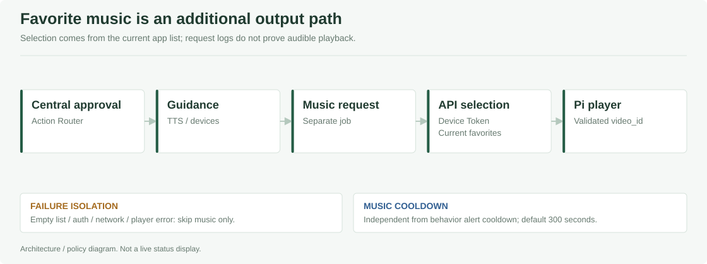

# PAUSEABLE / Edge

**AI가 판단을 보내면 Central이 실행 여부를 정하고, 장치별 모듈이 실제 출력을 맡습니다.** Raspberry Pi의 센서 중계·판단 수신·음성·가전·사진을 연결하는 런타임 영역입니다.

[전체 프로젝트](../README.md) · [AI 판단](../Pauseable.ai/README.md) · [배포 안내](../Pauseable.deploy/README.md)

## 구성

| 경로 | 장치 | 역할 |
| --- | --- | --- |
| [`central`](central) | Pi 5 / Atlas | MQTT 수신, 계약 검증, Action Router, API Gateway |
| [`mmwave-relay`](mmwave-relay) | Pi 3 | serial 입력 검증·중계·프로세스 관리 |
| [`camera`](camera) | Pi 4 | 카메라 버퍼·출입 이벤트 대표 사진·업로드 |
| [`voice-model`](voice-model) | Pi 5 | ONNX 다운로드·검증·교체 |
| [`actions/youtube`](actions/youtube) | Pi 5 | Chromium·화면·오디오 재생 브리지 |
| [`actions/favorite-music`](actions/favorite-music) | Pi 5 | 앱의 선호 음악 조회·검증·재생 요청 |

## Central App


| 단계 | 담당 역할 | 이후 단계로 넘기지 않는 사례 |
| --- | --- | --- |
| Subscriber / Validator | JSON·Topic/source·시각·ID 확인 | 출처 불일치·오래된 사건·잘못된 필드 |
| Decision / Dedup | 내부 결정으로 변환, 중복·동일 ID 충돌 구분 | 이미 처리한 사건·같은 ID의 다른 내용 |
| Action Router | 행동별 활성화·위험도·cooldown 확인 | 실행 비활성·억제 중인 동작 |
| Local / Gateway | 허용한 출력 실행, API 전송·재시도 | 관측 부족을 가전 명령으로 바꾸지 않음 |

<details>
<summary><strong>Central 기능별 코드 진입점</strong></summary>

| 기능 | 파일 |
| --- | --- |
| 앱 시작·설정·구성 요소 연결 | [`src/main.cpp`](central/src/main.cpp) |
| MQTT 연결·구독 | [`MqttDecisionSubscriber.cpp`](central/integration/src/MqttDecisionSubscriber.cpp) |
| 입력·시각·출처 검증 | [`BehaviorInference.cpp`](central/core/src/BehaviorInference.cpp) |
| 내부 Decision과 API Event | [`DecisionEvent.cpp`](central/core/src/DecisionEvent.cpp) |
| 실행·억제 정책 | [`ActionRouter.cpp`](central/core/src/ActionRouter.cpp) |
| 재전송 대기 상태 | [`DecisionOutbox.cpp`](central/integration/src/DecisionOutbox.cpp) |
| API 전송 | [`DecisionGatewayClient.cpp`](central/integration/src/DecisionGatewayClient.cpp) |
| 로컬 음성 합성 | [`PiperTtsEngine.cpp`](central/integration/src/PiperTtsEngine.cpp) |

</details>

### 입력과 실행의 경계

- 반복행동과 배회를 서로 다른 MQTT Topic에서 받고 `source` 일치 여부를 확인합니다.
- 기본적으로 300초보다 오래된 이벤트, 30초를 초과한 미래 이벤트는 거부합니다.
- `unknown`·잘못된 계약·실행 비활성 입력을 그대로 가전 제어에 연결하지 않습니다.
- 반복행동·배회의 활성화와 cooldown은 각각 설정합니다.
- Outbox는 API 전송 대기·재시도용 영속 상태입니다. 실제 TTS·가전 동작까지 보장하는 큐는 아닙니다.
- 최종 API 메시지와 중복 처리 계약은 [Contracts](../Pauseable.contracts/README.md)를 따릅니다.

<details>
<summary><strong>Central 빌드 환경과 독립 수신기 host 테스트</strong></summary>

정식 Central은 C++17·CMake와 Atlas/webOS SDK, `sdbus-c++`, 플랫폼 전용 라이브러리가 필요합니다. [`CMakeLists.txt`](central/CMakeLists.txt)에 의존성이 정의되어 있습니다. 일반 PC의 CMake만으로 정식 앱이나 `.ipk`까지 만들어지지는 않습니다.

독립 mmWave 수신기와 해당 host 테스트는 별도 C++ 도구입니다. C++17 toolchain과 CMake를 준비하고 **저장소 루트에서** 실행합니다.

```sh
cmake -S Pauseable.edge/central/mmwave-tools -B build/mmwave-tools -DBUILD_TESTING=ON
cmake --build build/mmwave-tools --config Release
ctest --test-dir build/mmwave-tools -C Release --output-on-failure
```

이는 Central 전체의 TTS·D-Bus·가전 E2E 시험이 아닙니다. Central host 테스트 소스는 [`central/tests`](central/tests)에 있습니다.

</details>

## 센서 릴레이와 카메라

| 파트 | 주요 파일 | 확인할 조건 |
| --- | --- | --- |
| mmWave 릴레이 | [`relay_supervisor.py`](mmwave-relay/relay_supervisor.py), [`validate_event.py`](mmwave-relay/validate_event.py) | serial 권한·센서 계약·Pi 5 주소·연결 복구 |
| Camera | [`camera_buffer.py`](camera/camera_buffer.py), [`Dockerfile`](camera/Dockerfile) | 카메라 권한·트리거 인증·대표 사진·업로드 인증 |

실제 주소와 토큰은 장치의 비공개 환경 파일에 둡니다. 카메라 설정은 [`camera.env.example`](camera/camera.env.example), HA 트리거는 [`camera/home-assistant`](camera/home-assistant)에 있습니다. 사진 업로드 성공과 앱에서 인증된 사진 조회 성공을 따로 확인합니다.

## 음성 모델 교체


[`voice_model_updater.py`](voice-model/voice_model_updater.py)는 API/R2에서 모델을 받아 크기·SHA-256·설정·로컬 합성 결과를 확인한 뒤 활성 모델을 교체합니다. 새 모델이 검증되지 않으면 기존 모델을 유지합니다.

환경 예시: [`voice-model.env.example`](voice-model/voice-model.env.example). 학습 원본과 보관·삭제 정책은 [Voice 데이터 정책](../Pauseable.docs/voice/DATA_AND_ARTIFACTS_KO.md)을 따릅니다.

## 선호 음악과 출력 경로



최근 변경은 **기존 반복행동의 고정 LG TV 영상 호출을 Pi의 선호 음악 경로로 통일**한 것입니다. 빈 목록·인증·네트워크·플레이어 오류는 음악 경로만 건너뜁니다. 기본 음악 cooldown은 300초이며 판단 알림 cooldown과 별도입니다.

| 상태 | 의미 |
| --- | --- |
| Central 승인 | 해당 안내·동작을 실행 정책상 허용 |
| API 전달 완료 | 서버가 사건을 접수함. TTS·가전 전체 성공과는 다름 |
| Player 요청 | 재생 요청 단계. 실제 화면·소리는 별도 확인 |
| 음악 조회·재생 실패 | 음악만 건너뛰고 기존 안내 경로와 분리해 기록 |

설치·수동 시험·로그·되돌리기는 [Favorite Music README](actions/favorite-music/README.md)에 있습니다. 재생 요청 로그만으로 실제 영상과 소리가 나왔다고 기록하지 않습니다.

## 실기 점검 순서

1. 배포 전 기존 설정·모델·DB·서비스를 백업합니다.
2. 센서 입력과 AI 메시지를 확인합니다.
3. Central의 검증·허용·억제 사유를 확인합니다.
4. TTS·가전·음악 출력을 각각 실제 장치에서 확인합니다.
5. 같은 `event_id`로 Outbox·API 이력·휴대폰 표시를 대조합니다.

실행 허용이나 systemd 시작은 실제 장치에 영향을 줄 수 있습니다. [장치별 배포 인계](../Pauseable.docs/DEPLOYMENT_HANDOFF.txt)와 [HA 시연 절차](../Pauseable.docs/ha/DEMO_RUNBOOK_KO.md)를 확인한 뒤 진행합니다.
