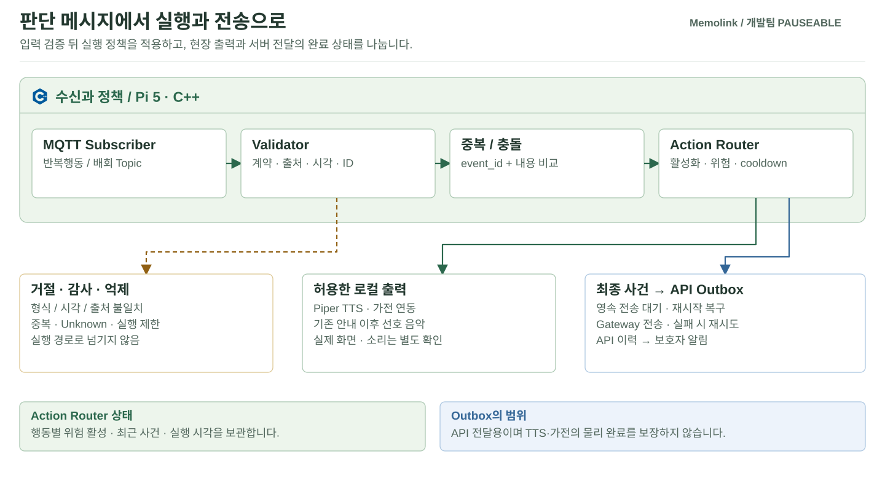

# Memolink Central App

[장치 실행 구성](../README.md) · [통신 규격](../../Pauseable.contracts/README.md) · [기능별 코드](../../Pauseable.docs/SOURCE_MAP_KO.md#central-수신과-실행) · [배포](../../Pauseable.deploy/README.md)

AI가 전송한 반복행동·배회 메시지를 받아 실행 여부를 결정하는 C++ 앱입니다. AI의 `risk` 값을 바로 가전 명령으로 사용하지 않고, 입력과 실행 조건을 검사합니다.



## 입력부터 출력까지

| 단계 | 구현 | 처리 |
| --- | --- | --- |
| MQTT 구독 | [MqttDecisionSubscriber.cpp](integration/src/MqttDecisionSubscriber.cpp) | 반복행동·배회 Topic 수신 |
| 입력 검증 | [BehaviorInference.cpp](core/src/BehaviorInference.cpp) | 필드·출처·시각·식별자·중복 확인 |
| 내부 결정 | [DecisionEvent.cpp](core/src/DecisionEvent.cpp) | 최종 Decision Event 형식 |
| Action Router | [ActionRouter.cpp](core/src/ActionRouter.cpp) | 행동별 활성화·위험 단계·cooldown |
| 로컬 출력 | [PiperTtsEngine.cpp](integration/src/PiperTtsEngine.cpp), [deploy](deploy) | 허용한 음성·가전 출력 연결 |
| API 전송 | [DecisionOutbox.cpp](integration/src/DecisionOutbox.cpp), [DecisionGatewayClient.cpp](integration/src/DecisionGatewayClient.cpp) | 영속 전송 대기와 재시도 |

기본 사건 시각 허용 범위는 과거 300초, 미래 30초입니다. Topic과 `source`가 다르거나 유효하지 않은 입력은 실행으로 전달하지 않습니다. Outbox는 API 전달을 재시도하는 상태이며, 실제 음성·가전 동작 완료를 보장하는 작업 큐와는 다릅니다.

## 빌드와 검사

정식 앱은 [CMakeLists.txt](CMakeLists.txt)의 C++17·sdbus-c++·OpenSSL·Atlas 라이브러리와 SDK 환경이 필요합니다. `PAUSEABLE_BUILD_TESTS`를 켜는 것만으로 일반 PC에서 Atlas 의존성이 제거되지는 않습니다.

독립 mmWave 수신기 도구의 host 검사만 수행하는 명령입니다. 저장소 루트에서 실행합니다.

```sh
cmake -S Pauseable.edge/central/mmwave-tools -B build/mmwave-tools -DBUILD_TESTING=ON
cmake --build build/mmwave-tools --config Release
ctest --test-dir build/mmwave-tools -C Release --output-on-failure
```

[tests](tests)의 Central 회귀 소스, [MQTT 입력 시험 스크립트](scripts/test_mqtt_intake.sh), [앱 메타데이터](files/appinfo.json)를 구분해 확인합니다. 실제 MQTT 입력 시험과 서비스 시작은 연결된 출력에 영향을 줄 수 있으므로 시험 장치와 설정에서 수행합니다.

## 장치 적용

소스 업데이트, SDK 빌드, `.ipk` 설치, 환경 파일과 서비스 적용, 실기 확인은 각각의 단계입니다. [배포 안내](../../Pauseable.deploy/README.md)와 [배포 인계](../../Pauseable.docs/DEPLOYMENT_HANDOFF.txt)를 따릅니다. 서버 접수 이후에는 TTS·가전·사진·휴대폰 표시를 같은 사건 ID로 대조합니다.
