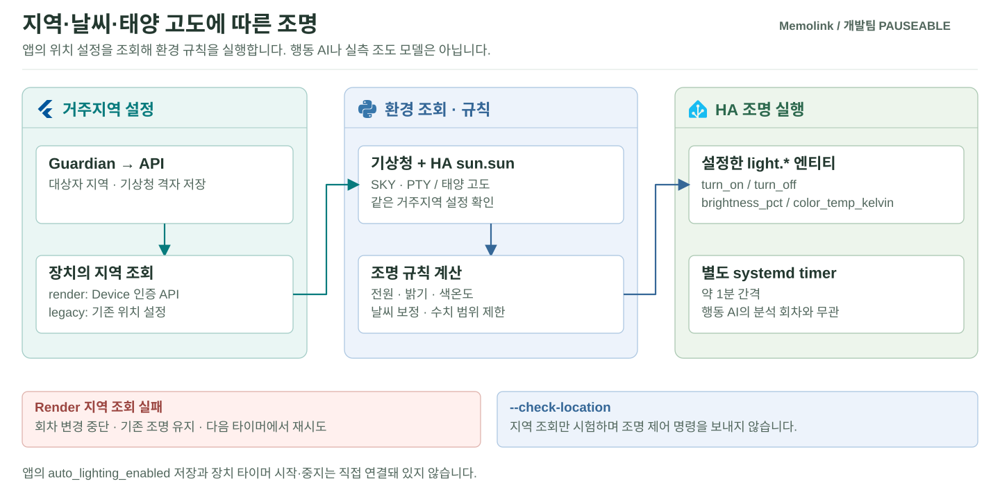

# 거주지역·날씨·조명 연동

보호자 앱의 거주지역 설정, 기상청 날씨와 HA의 태양 고도를 조명 제어에 사용하는 모듈입니다. 조회한 환경 정보에 밝기·색온도 규칙을 적용해 HA 조명 엔티티에 전달합니다. 반복행동·배회 판단과는 별도로 동작합니다.

**행동 분석이 아니라 생활 환경을 조절하는 경로**입니다. 보호자가 등록한 지역을 바탕으로 환경 정보를 가져오고, 미리 정한 조명 규칙을 실행합니다. 앱 설정 저장·장치 조회·실제 조명 반응을 각각 확인합니다.

[전체 프로젝트](../README.md) · [API·앱](../Pauseable.apps/README.md) · [배포 안내](../Pauseable.deploy/README.md)

[처리 과정](#처리-과정) · [준비할 설정](#준비할-설정) · [로컬 검사](#로컬-검사와-조회-시험) · [장치 적용](#장치-적용과-확인)



## 처리 과정

이 모듈은 행동 AI가 아니라 **환경 조명 규칙**입니다. 지역 설정, 날씨·태양 고도 조회, 밝기·색온도 계산, HA 명령을 분리합니다.

| 입력·단계 | 하는 일 |
| --- | --- |
|  Guardian 지역 | 앱이 저장한 대상자별 거주 지역 확인 |
|  위치 조회 | Device 인증으로 API의 지역과 기상청 `nx/ny` 조회 |
|  환경 정보 | 기상청 날씨와 HA `sun.sun`의 태양 고도 사용 |
|  규칙 적용 | 밝기·색온도 규칙으로 HA 조명 엔티티에 명령 |
|  오류 처리 | Render 모드의 위치 조회 실패 시 해당 회차 변경 중단 |

systemd 타이머는 약 1분 간격으로 실행됩니다. HA AI의 상태 변경 수집과 별개의 주기이며, 지역 조회와 조명 명령 결과를 기록합니다.

### 조명 계산 규칙

[`calculate_light()`](home-assistant/weather-light-control/weather_api.py)는 태양 고도에 따라 기본 밝기·색온도를 계산하고 기상청 `SKY`·`PTY`로 보정합니다.

| 항목 | 현재 코드 |
| --- | --- |
| 기본 밝기 | 고도 20° 이상 10%, −6° 이하 70%, 사이는 선형 계산 |
| 날씨 보정 | 구름 많음 +10, 흐림 +20, 강수 +20; 밝기 0~97% 제한 |
| 기본 색온도 | 고도에 따라 2,700~4,500 K, 흐림·강수로 보정; 2,500~6,500 K 제한 |
| 전원 조건 | 고도 20° 미만 또는 구름 많음·흐림·강수일 때 켬; 그 외 끔 |
| HA 실행 | 설정한 `light.*`에 `turn_on`/`turn_off`, 밝기·색온도 전달 |

기본 밝기 계산과 전원 조건은 별개입니다. 맑은 낮에 계산값이 10%여도 전원 조건에 따라 꺼질 수 있습니다. 조도 센서의 실측 lux나 학습 모델로 조명을 조절하는 기능은 아닙니다.

<details>
<summary><strong>구현 파일과 설정 위치</strong></summary>

| 파일 | 역할 |
| --- | --- |
| [`weather_api.py`](home-assistant/weather-light-control/weather_api.py) | 지역·날씨 조회와 HA 조명 밝기·색온도 처리 |
| [`weather_location.py`](home-assistant/weather-light-control/weather_location.py) | 위치 설정과 Render 지역 조회 |
| [`config.example.json`](home-assistant/weather-light-control/config.example.json) | 기상청·HA·조명 엔티티 설정 형식 |
| [`render-location.env.example`](home-assistant/weather-light-control/render-location.env.example) | Device 인증·지역 출처 설정 예시 |
| [`deploy/systemd`](home-assistant/weather-light-control/deploy/systemd) | 서비스와 타이머 |
| [`test_weather_api.py`](home-assistant/weather-light-control/test_weather_api.py) | API·위치 연동 회귀 검사 |

</details>

## 모드와 실패 처리

| 모드 | 동작 |
| --- | --- |
| `WEATHER_LOCATION_SOURCE=render` | 앱에 저장된 지역을 Device 인증 API로 조회 |
| `legacy` 또는 미설정 | 기존 장치의 위치 설정 사용 |
| Render 조회 실패·지역 미설정·격자 오류 | 해당 회차 조명 변경 중단, 다음 실행에서 재시도 |

Render 모드에서 위치 조회에 실패하면 해당 회차 변경을 중단하고 다음 실행에서 재시도합니다. 로컬 지역으로 자동 전환하거나 조명을 끄는 대신 기존 상태를 유지합니다. 태양 고도 계산에 사용하는 HA의 집 위치도 실제 거주지역과 맞춰 설정합니다.

## 준비할 설정

<details>
<summary><strong>비공개 설정 체크리스트</strong></summary>

| 항목 | 위치·주의 |
| --- | --- |
| 기상청 Service Key | 장치의 비공개 `config.json` |
| HA 주소·장기 Token·조명 Entity ID | 장치의 비공개 `config.json` |
| Render API·대상자·Device Token | 비공개 `render-location.env` |
| 실제 거주 지역 | Guardian에서 저장하고 API 영속 저장 여부 확인 |

실제 값은 장치의 비공개 설정 파일에 저장합니다. 기존 설정을 백업하고 파일 읽기 권한을 제한합니다. 조명 장치는 Device Token을 사용하며, 인증값은 소스·로그에서 제외합니다.

</details>

## 로컬 검사와 조회 시험

<details>
<summary><strong>회귀 검사와 조명을 바꾸지 않는 조회 명령</strong></summary>

별도 Python 가상환경을 활성화하고 **저장소 루트에서** 시작합니다.

```sh
cd Pauseable.integrations/home-assistant/weather-light-control
python -m pip install -r requirements.txt
python -m unittest -v test_weather_api.py
```

장치의 비공개 환경 파일을 준비한 뒤 Linux 셸에서 다음처럼 조회만 확인할 수 있습니다.

```sh
chmod 600 render-location.env
set -a
. ./render-location.env
set +a
python weather_api.py --check-location
```

`--check-location`은 조명 명령 없이 위치 조회만 검사합니다. 옵션 없는 실행과 서비스 시작은 실제 조명 제어를 수행합니다.

</details>

## 장치 적용과 확인

장치 경로·서비스·타이머·Docker 실행과 복귀 절차는 [지역 설정 연동 가이드](../Pauseable.docs/integrations/home-assistant/RENDER_REGION_SETUP_KO.md)를 따릅니다. 저장소 타이머는 약 1분 간격으로 실행하도록 구성되어 있습니다.

1. API 지역 조회 성공을 확인합니다.
2. 반환 격자와 대상자 일치를 확인합니다.
3. 다음 타이머 실행과 실제 조명 반응을 확인합니다.
4. 통신 실패 시 조명 변경이 중단되는지 확인합니다.

앱 설정 저장, 장치의 위치 조회와 조명 변경은 각각 확인합니다. 현재 `auto_lighting_enabled` 저장 기능과 장치 타이머의 시작·중지는 직접 연결된 기능이 아닙니다.
