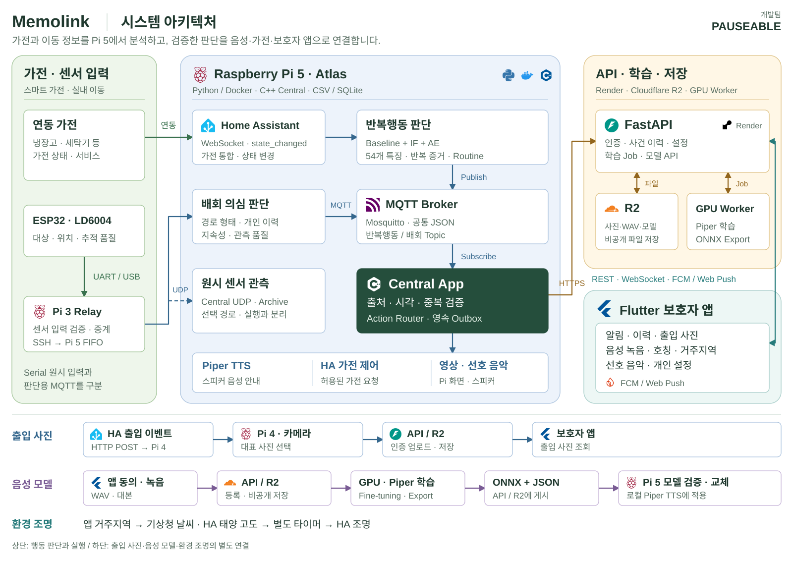

# Memolink

### 가전 사용과 실내 이동을 분석하는 생활 안전 보조 시스템

Home Assistant · mmWave · Raspberry Pi · Personalized Voice

**임베디드 SW 경진대회 | 스마트 가전 부문**

**개발팀 PAUSEABLE**

[시스템 구조](#시스템-아키텍처) · [개발환경](Pauseable.docs/DEVELOPMENT_ENVIRONMENT_KO.md) · [기능별 코드](Pauseable.docs/SOURCE_MAP_KO.md) · [실행 안내](#실행과-검토) · [검증 자료](Pauseable.docs/README.md#평가-자료-읽기)

---

## 프로젝트 소개

Memolink는 치매환자를 위한 **스마트 가전 AIoT 시스템**입니다. 가전 사용 이력과 실내 이동 경로를 분석해 반복행동과 배회 의심 상황을 알립니다. 치매 환자의 일상생활을 돕고, 보호자가 떨어져 있을 때도 상황을 확인할 수 있도록 개발했습니다.

가전 정보는 Home Assistant에서, 이동 정보는 mmWave 센서에서 수집합니다. Raspberry Pi 5에서 두 정보를 각각 분석한 뒤, C++로 구현한 **Central App**이 판단 결과를 검증하고 음성 안내·가전 동작·보호자 알림을 결정합니다. 보호자는 Flutter 앱에서 알림과 출입 사진을 확인하고, 안내에 사용할 음성·호칭·지역·선호 음악을 등록합니다.

## 개발 목표

- **수집 초기부터 판단:** 개인 이력이 부족한 시기에는 Baseline을 사용하고, 유효 이력이 쌓이면 IF·AE와 개인 생활패턴을 반영합니다.
- **Pi 중심의 현장 처리:** HA 데이터 수집, 행동 분석, Central과 TTS를 Pi 5에서 실행하는 구조로 구성했습니다.
- **판단과 실행 분리:** AI 결과를 곧바로 가전 명령으로 사용하지 않고, 출처·시각·중복과 실행 조건을 확인합니다.
- **보호자 설정 반영:** 보호자가 등록한 정보가 음성 안내·지역 기반 조명·선호 음악 재생에 사용되도록 연결했습니다.

## 주요 기능

| 주요 기능 | 처리 방식 |
| --- | --- |
| 가전 반복행동 분석 | 상태 변경 이력 → 시간 구간별 특징 → Baseline + Isolation Forest + Autoencoder. [HA 구현](Pauseable.ai/ha/README.md) |
| 배회 의심 상황 분석 | mmWave 이동 경로 → 반복 형태·지속성·개인 이력 비교. [mmWave 구현](Pauseable.ai/mmwave/README.md) |
| 상황별 안내와 출력 | Central 승인 → Piper TTS·설정된 가전 동작·선호 음악 재생 요청 |
| 보호자 연결 | API → 알림 이력·WebSocket·FCM/Web Push, 출입 사진 확인 |
| 개인화 음성 | 보호자 동의·녹음 → GPU 학습 → ONNX 검증 → Pi 음성 모델 교체. [Voice 구현](Pauseable.ai/voice/README.md) |

## 시스템 아키텍처

반복행동과 배회 판단은 서로 다른 파이프라인으로 처리합니다. 각 판단 모듈이 공통 JSON 형식의 MQTT 메시지를 보내면 Central이 이를 수신합니다. 가전·이동 분석과 로컬 음성 합성은 Pi에서 실행하고, 앱 연결·모델 저장·보호자 음성 학습은 API 서버·R2·GPU Worker가 담당합니다.

| 실행 위치 | 담당 역할 |
| --- | --- |
| Raspberry Pi 3 | ESP32/mmWave 센서 입력 릴레이 |
| Raspberry Pi 4 | 카메라 버퍼와 출입 이벤트 대표 사진 |
| Raspberry Pi 5 / Atlas | HA·mmWave 판단, C++ Central, 로컬 TTS와 가전 연동 |
| API 서버 / Render | 앱·장치 인증, 알림 저장·전달, 음성 학습 작업과 모델 배포 API |
| GPU Worker / R2 | Piper 학습·ONNX Export, 녹음과 모델의 비공개 저장 |
| Flutter 앱 | 보호자의 상태 확인·설정·음성 녹음 |

## 동작 흐름

1. HA 상태 변경과 mmWave 이동 정보를 수집합니다. 데이터 누락과 관측 품질도 함께 기록합니다.
2. 가전 사용 특징과 이동 경로를 분석해 판단 상태와 근거를 생성합니다.
3. Central이 메시지 형식·출처·사건 시각·중복 여부를 검사합니다.
4. Action Router가 행동 종류, 위험 단계와 재실행 제한 시간을 확인해 출력을 허용하거나 억제합니다.
5. 허용된 음성·가전 출력을 실행하고, 최종 Decision Event를 API로 전송해 보호자 앱에 전달합니다.

| 연결 | 인터페이스 |
| --- | --- |
| 반복행동 AI → Central | MQTT `pauseable/ai/repetitive/decision` |
| 배회 AI → Central | MQTT `pauseable/ai/wandering/decision` |
| Central → API | HTTPS `POST /api/events/decisions` |
| API → 보호자 앱 | REST·WebSocket·FCM/Web Push |

세부 필드와 검증 규칙은 [통신 계약 안내](Pauseable.contracts/README.md)에 정리되어 있습니다.

## 소스 구성

소스는 기능과 실행 환경에 따라 나누었습니다. 각 영역의 README에는 처리 구조, 주요 코드, 실행 방법과 검증 범위를 정리했습니다.

작품명은 Memolink, 팀명은 PAUSEABLE입니다. 기존 실행 환경과의 호환성을 위해 저장소·폴더·서비스·MQTT Topic의 `Pauseable`·`pauseable` 식별자는 유지합니다.

| 폴더 | 내용 | 문서 |
| --- | --- | --- |
| `Pauseable.ai` | HA 반복행동·mmWave 배회 분석·음성 학습 | [AI README](Pauseable.ai/README.md) |
| `Pauseable.apps` | FastAPI 서버·Flutter 보호자 앱 | [Apps README](Pauseable.apps/README.md) |
| `Pauseable.edge` | Central·카메라·센서 릴레이·음성 모델 교체·출력 | [Edge README](Pauseable.edge/README.md) |
| `Pauseable.contracts` | 공통 JSON Schema와 이벤트 계약 | [Contracts README](Pauseable.contracts/README.md) |
| `Pauseable.deploy` | 장치별 배포 묶음·서비스 설정·이전 설정 대응표 | [Deploy README](Pauseable.deploy/README.md) |
| `Pauseable.integrations` | Home Assistant 날씨·지역·조명 연동 | [Integrations README](Pauseable.integrations/README.md) |
| `Pauseable.docs` | 설계·평가·보고서·장치 운영 자료 | [문서 및 검증 자료](Pauseable.docs/README.md) |
| `.github` | 자동 검사와 Android 시험 APK 빌드 | [CI README](.github/CI_README.md) |

`Pauseable.third_party`에는 외부 소스와 저작권 고지를 보존합니다. 별도 사용 조건은 해당 원본 고지를 확인합니다.

## 개발 환경

| 영역 | 주요 기술 |
| --- | --- |
| 데이터·AI | Python, NumPy, pandas, scikit-learn, SQLite |
| Central | C++17, CMake, Atlas/webOS SDK, D-Bus |
| 앱·API | Flutter/Dart, FastAPI, Uvicorn |
| 통신 | MQTT, JSON Schema, HTTPS, WebSocket |
| 음성 | Piper, ONNX, Docker GPU 학습 파이프라인 |
| 운영 | Docker, systemd, GitHub Actions, Render, R2, Firebase |

Python 의존성은 파트별 가상환경으로 분리합니다. HA/API CI는 Python 3.12, Voice CI는 Python 3.11, Flutter CI는 Flutter 3.47.6을 사용합니다. Central 정식 앱 빌드에는 Atlas SDK와 전용 라이브러리가 필요합니다.

장치·Runtime·의존성 버전과 준비 방법은 [개발환경](Pauseable.docs/DEVELOPMENT_ENVIRONMENT_KO.md)에 정리했습니다. 이벤트 처리·학습·실행 정책은 각 모듈의 구현 설명에서 다룹니다.

## 실행과 검토

| 확인 목적 | 자료 |
| --- | --- |
| 개발 도구와 실행 환경 준비 | [개발환경](Pauseable.docs/DEVELOPMENT_ENVIRONMENT_KO.md) |
| 기능을 구현한 파일 찾기 | [기능별 코드 위치](Pauseable.docs/SOURCE_MAP_KO.md) |
| 판단 알고리즘과 학습 과정 | [AI 구성](Pauseable.ai/README.md) |
| 메시지 수신·실행 제어 | [통신 규격](Pauseable.contracts/README.md), [Central 및 장치 모듈](Pauseable.edge/README.md) |
| 로컬 API·앱 실행 | [Apps 실행 안내](Pauseable.apps/README.md), [보호자 앱 상세](Pauseable.apps/guardian/README.md) |
| 장치 설치·서비스 설정 | [장치별 배포](Pauseable.deploy/README.md) |
| 실험 조건·결과·보고서 | [검증 자료](Pauseable.docs/README.md#평가-자료-읽기) |

## 검증과 적용 범위

| 구분 | 저장소에 포함된 근거 | 확인 범위 |
| --- | --- | --- |
| HA | [2026-10-23 검증 기록](Pauseable.docs/evaluation/ha/verification_summary.json) | unit 184개·report 16개 기록, 합성 데이터 기반 학습·갱신·시나리오 시험 |
| mmWave | [`shape_v2` 평가](Pauseable.ai/mmwave/src/shape_v2/artifacts/metrics.json) | 경로 형태 연구 모델, 실측 LD6004·임상 배회 성능 미검증 |
| Central·앱·음성 | 파트별 테스트·[CI](.github/CI_README.md)·[앱 검증 기록](Pauseable.apps/guardian/README.md#7-검증-결과와-남은-확인) | 메시지 검증·라우팅·앱/API·음성 처리 검사. 장치별 설치와 실기 확인은 별도 |

여기서 소개한 HA·경로 형태 평가는 합성 자료를 사용했습니다. 반복 입력의 경보 변화와 정상 사례의 경보, Routine 보정 결과를 구분해 제시합니다. 실험 조건·결과 수치·미실행 항목은 [검증 자료](Pauseable.docs/README.md#평가-자료-읽기)에서 확인할 수 있습니다.

## 적용 범위와 개인정보

이 시스템은 생활 안전을 돕기 위한 연구·시연용 구현으로, 의료적 진단이나 안전을 보장하지 않습니다. MQTT 수신 확인과 API 접수 응답은 실제 음성·가전·휴대폰 출력 성공과 구분합니다.

Pi 내부의 판단과 TTS는 로컬에서 처리하지만, 제조사 클라우드 가전·외부 API·Push·R2 사용에는 해당 서비스 연결이 필요합니다. 코드 반영 후에는 Pi·서버·앱에 맞는 설치 및 확인 절차를 거칩니다.

개인 이력·사진·녹음·개인화 모델·인증값은 저장소에 포함하지 않습니다. 음성 수집에는 동의 기록을 사용하며, 데이터 보관·삭제 기준은 [음성 데이터 정책](Pauseable.docs/voice/DATA_AND_ARTIFACTS_KO.md)에 정리했습니다. 현재 팀 시험용 공유 토큰 구조는 사용자별 인증·권한 분리와 구분됩니다.

## 외부 소스

[Piper 원본 정보](Pauseable.ai/voice/provenance), [외부 저작권 고지](Pauseable.third_party/NOTICE.txt), [nlohmann/json 라이선스](Pauseable.third_party/nlohmann/LICENSE.MIT)를 포함합니다. 외부 코드·데이터·모델은 각 원본의 이용 조건을 따릅니다. 프로젝트 전체의 재사용 라이선스는 별도로 정의하지 않았습니다.
