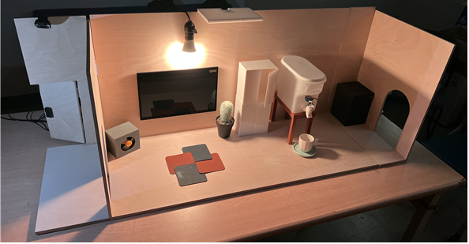
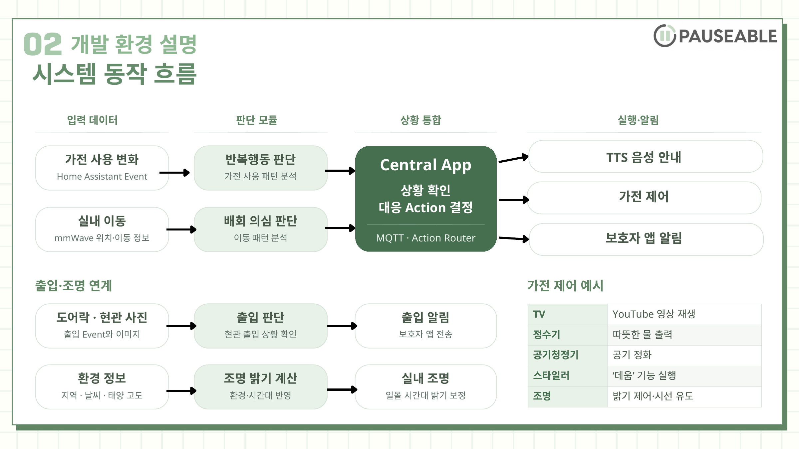
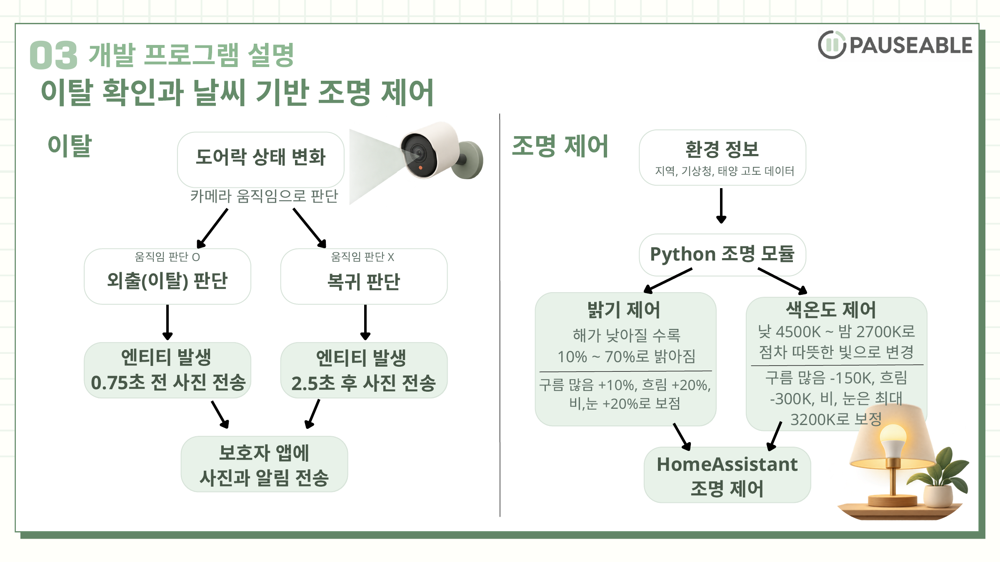
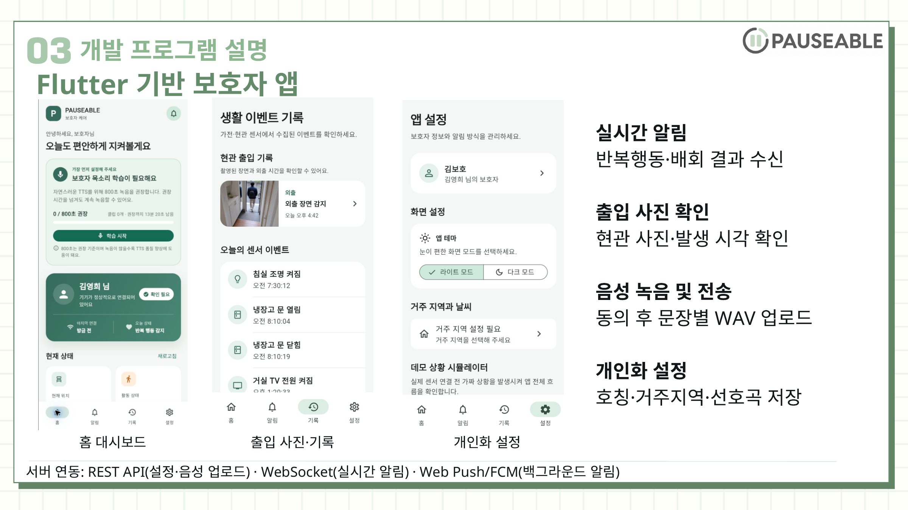

# Memolink

<a id="개발-목표"></a>
<a id="개발-환경"></a>
<a id="개인화가-적용되는-과정"></a>
<a id="검증과-적용-범위"></a>
<a id="동작-흐름"></a>
<a id="소스-구성"></a>
<a id="시스템-아키텍처"></a>
<a id="실행과-검토"></a>
<a id="외부-소스"></a>
<a id="운영-범위와-개인정보"></a>
<a id="프로젝트-소개"></a>

**치매 환자를 위한 스마트 가전 AIoT 시스템**

임베디드 소프트웨어 경진대회 · 스마트 가전 부문 · 개발팀 PAUSEABLE

Memolink는 집 안의 가전 사용과 실내 이동을 기록하고, 반복행동과 배회 의심 상황을 분석합니다. Raspberry Pi 5의 Central은 판단 메시지를 검증해 음성 안내와 연결된 가전 출력을 실행하고, API를 통해 보호자 앱에 사건 알림을 전달합니다. 출입 사진은 Pi 4 카메라가 촬영해 API로 업로드합니다.

[시연 모형](#시연-모형) · [주요 기능](#주요-기능) · [시스템 구성](#시스템-구성) · [핵심 연동](#핵심-연동) · [폴더 구조](#폴더-구조)

## 시연 모형



디스플레이·조명·출입구와 가전 모형을 배치한 스마트홈 시연 공간입니다. 실내 이동과 가전 사용을 관찰하고, 상황에 맞는 화면·음성·조명 출력과 보호자 앱 연결을 보여줍니다.

## 프로젝트 개요

| 구분 | 내용 |
| --- | --- |
| 가전 사용 분석 | Home Assistant 상태 변경을 특징으로 만들고 Baseline·개인 모델로 반복 사용 판단 |
| 실내 이동 분석 | mmWave 대상 좌표에서 경로 형태·개인 변화·지속성 확인 |
| 현장 대응 | Central 실행 정책에 따른 로컬 TTS와 등록된 출력 경로 호출 |
| 보호자 확인 | Flutter 앱의 사건 알림·출입 사진·돌봄 설정 |
| 개인화 음성 | 동의한 보호자 녹음으로 Piper 모델을 학습하고 Pi에서 검증 후 적용 |

## 주요 기능

| 기능 | 처리 과정 | 담당 폴더 |
| --- | --- | --- |
| 반복행동 감지 | 가전 이벤트 → 사용 특징 → 규칙·IF·AE → MQTT 판단 | [AI](Pauseable.ai/README.md) |
| 배회 의심 판단 | 센서 좌표 → 이동 구간 → 경로·개인 이력·지속성 | [AI](Pauseable.ai/README.md#mmwave-구현과-설치-상세) |
| 음성·현장 출력 | 추론 검증 → Action Router → TTS·출력 Watcher | [Edge](Pauseable.edge/README.md) |
| 출입 사진 | 가상 도어락 이벤트 → Pi 4 카메라 버퍼 → API → 앱 | [카메라](Pauseable.edge/README.md#카메라-트리거와-업로드) |
| 선호 음악 | 앱 등록곡 → 현재 목록 조회 → 안내 이후 Pi 또는 HA LG TV 재생 요청 | [Edge](Pauseable.edge/README.md#선호-음악-설치와-시험) |
| 환경 조명 | 앱의 거주지역·예보·태양 고도 → 밝기·색온도 계산 → HA | [Integrations](Pauseable.integrations/README.md) |
| 알림 일시 중지 | 대상자별 반복행동 알림의 만료 시각 저장·복원 | [Apps](Pauseable.apps/README.md) |

## 시스템 구성

| 구성 | 역할 |
| --- | --- |
| LD6004·ESP32 | 실내 대상의 위치·추적 정보를 생성 |
| Pi 3 또는 센서용 Pi | ESP32 USB 전원 공급 또는 저장소의 Serial 릴레이 운용 |
| Pi 4 | 출입 카메라 버퍼와 대표 사진 업로드 |
| Pi 5·Atlas | Home Assistant, 행동 AI, MQTT, C++ Central, 로컬 TTS |
| Render·FastAPI | 사건·설정·사진·음성 작업 관리와 알림 전달 |
| GPU Worker·Piper | 보호자 녹음 전처리·학습·ONNX 게시 |
| Cloudflare R2 | 비공개 사진·녹음·음성 모델 저장 |
| Flutter Guardian | Android·웹 보호자 화면 |

<a id="데이터-처리-흐름"></a>

### ① 데이터 처리 흐름



개발완료보고서 5쪽의 시스템 동작 흐름입니다. 가전 사용과 실내 이동을 각각 분석한 뒤 Central이 대응을 결정하고, 출입 사진과 환경 조명은 각 연동 경로에서 처리합니다. 그림의 가전 제어 표는 연결 대상을 설명하는 예시입니다.

```text
Home Assistant → HA 반복행동 AI ─┐
                               ├→ MQTT → Central 검증·실행 → 로컬 TTS·출력
mmWave 수신 경로 → 배회 AI ──────┘                   └→ API → 보호자 앱 알림

가상 도어락 → Pi 4 카메라 → API/R2 → 보호자 앱 사진
보호자 녹음 → API/R2 → GPU 학습 → ONNX 게시 → Pi 검증·교체
앱 거주지역 → 기상청·HA 태양 고도 → 별도 조명 타이머
```

## 핵심 연동

### ① 행동 분석과 개인화

| 분석 대상 | 처리 흐름 |
| --- | --- |
| 가전 반복행동 | HA 상태 변경 → 가전 동작·시간 특징 → Baseline·IF·AE → 반복 패턴과 생활 Routine 반영 |
| 실내 배회 의심 | mmWave 좌표 → 이동 구간 → 경로 형태·개인 이력 비교 → 지속성 판단 |
| 중앙 실행 | MQTT 판단 → 계약·사건 검증 → Action Router → 현장 출력과 보호자 사건 전송 |

두 행동 분석 모듈은 대상자의 관측 이력과 현재 구간을 사용하고, Central은 위험 단계·상태 전환·재알림 간격에 따라 실행 계획을 만듭니다. 분석 방법과 모델 구성은 [AI](Pauseable.ai/README.md), 실행 정책과 장치 연결은 [Edge](Pauseable.edge/README.md)에 정리했습니다.

### ② 출입 확인과 환경 조명



개발완료보고서 11쪽의 출입·조명 연결 구성입니다. 가상 도어락 해제 시 Pi 4 카메라가 요청 전후의 움직임을 비교하고, 외출은 요청 수신 0.75초 전, 복귀는 2.5초 후에 가까운 대표 사진을 선택해 보호자 앱에 전달합니다.

조명은 앱의 거주지역, 기상청 예보와 HA의 태양 고도로 전원·밝기·색온도를 계산합니다. 태양 고도가 낮아질수록 기본 밝기를 높이고 색온도를 따뜻하게 조절하며, 구름과 강수 상태로 값을 보정합니다. 상세 설정은 [카메라](Pauseable.edge/README.md#카메라-트리거와-업로드)와 [환경 조명](Pauseable.integrations/README.md)에서 확인할 수 있습니다.

### ③ 보호자 앱



개발완료보고서 12쪽에 수록한 보호자 앱 구성입니다. 앱은 반복행동·배회 알림과 출입 사진을 확인하고, 대상자 정보·거주지역·선호곡·알림 일시 중지·음성 녹음을 설정합니다.

FastAPI와 REST API로 설정·녹음을 주고받고, WebSocket으로 실시간 알림을 수신합니다. Android 백그라운드 알림은 FCM, 웹 알림은 Web Push로 연결합니다. 최신 화면과 API 구현은 [Apps](Pauseable.apps/README.md)에 정리했습니다.

### ④ 보호자 목소리 안내

보호자가 동의 후 문장별 음성을 녹음하면 API가 WAV·대본과 학습 Job을 관리합니다. GPU Worker는 전처리한 녹음으로 Piper를 학습하고 ONNX·설정을 게시합니다. Pi는 파일 무결성과 시험 합성을 확인한 뒤 활성 모델을 교체합니다.

Central은 상황에 맞는 새 안내 문장을 로컬 Piper로 합성해 재생하고, 선호 음악과 연결된 가전 출력을 함께 요청합니다. [음성 학습](Pauseable.ai/README.md#voice-학습과-운영-상세), [모델 교체](Pauseable.edge/README.md#음성-모델-교체), [선호 음악](Pauseable.edge/README.md#선호-음악-설치와-시험)에 각 처리 과정을 정리했습니다.

## 소프트웨어 구성

| 영역 | 주요 기술 | 설명 |
| --- | --- | --- |
| 행동 AI | Python 3.12, NumPy·pandas·scikit-learn | 가전 특징·모델, 이동 경로·지속성 |
| Central | C++17, CMake, sdbus-c++, OpenSSL, Atlas SDK | MQTT 검증·실행 정책·Outbox·TTS |
| API | FastAPI, Uvicorn, boto3, Firebase Admin | REST·WebSocket·파일·Push |
| 보호자 앱 | Flutter·Dart, Firebase Messaging | 화면·알림·녹음·설정 |
| 음성 학습 | Python 3.11, Piper·PyTorch·ONNX, Docker GPU | 음성 모델 학습과 Export |
| 장치 운용 | MQTT·HTTPS·systemd·Docker | 서비스 실행과 장치별 배포 |

## 폴더 구조

```text
2026ESWContest_smart_Pauseable/
├── .github/                  # 저장소 문서 이미지와 자동검사 설정
│   ├── assets/               # 최상위 README의 시연 사진·보고서 그림
│   │   └── readme/
│   └── workflows/
├── Pauseable.ai/             # 행동 분석과 보호자 음성 학습
│   ├── assets/
│   ├── ha/                   # 가전 이벤트 수집·개인화·반복행동 판단
│   ├── mmwave/               # 이동 경로·개인 변화·지속성 판단
│   └── voice/                # 녹음 전처리·Piper 학습·모델 게시
├── Pauseable.apps/           # 보호자 Flutter 앱과 FastAPI 서버
│   ├── api/                  # 인증·사건 저장·Push·사진·학습 API
│   └── guardian/             # Flutter 보호자 앱
├── Pauseable.contracts/      # 공통 JSON 규격과 메시지 예시
│   ├── communication-v1/     # AI→Central→API→앱 연결 규격
│   └── examples/
├── Pauseable.deploy/         # 장치별 소스 묶음·서비스·이전 설정
│   ├── gpu/                  # GPU 음성 학습 장치 설정
│   ├── migration/
│   ├── mmwave-autostart/     # 소스 Manifest·장치별 묶음 생성기
│   └── pi5/                  # Pi 5 앱·Gateway·웹 실행 설정
├── Pauseable.edge/           # Central·센서·카메라·로컬 출력
│   ├── actions/              # 안내 이후 실행하는 음악·화면 출력
│   ├── camera/               # 카메라 버퍼·대표 사진 선택·업로드
│   ├── central/              # Atlas C++ 중앙 판단·실행 앱
│   ├── mmwave-relay/         # Serial 계약 검사·SSH/FIFO 전달·시뮬레이션
│   └── voice-model/          # ONNX 모델 다운로드·검증·활성화
├── Pauseable.integrations/   # Home Assistant 기반 환경 조명 연동
│   └── home-assistant/       # Home Assistant 외부 기능 연동
├── Pauseable.third_party/    # 외부 라이브러리와 원본 고지
│   ├── nlohmann/             # C++ JSON 단일 헤더와 MIT 라이선스
│   └── piper1-gpl/           # Piper 1.5.0 원본 기반 TTS·학습 소스
└── README.md                 # 프로젝트 개요·시연 사진·전체 구성
```
