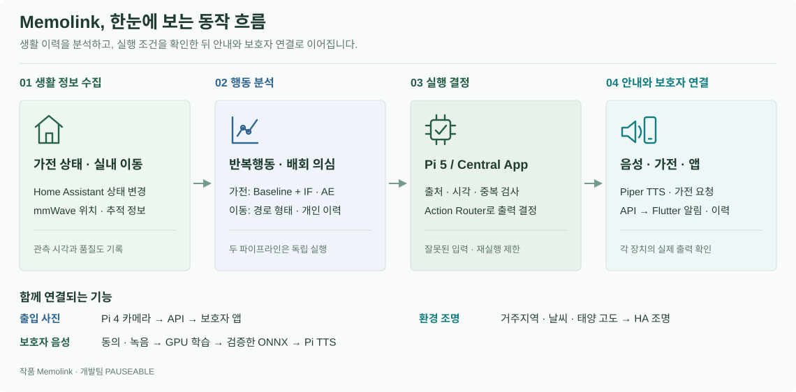

# Memolink

### 치매 환자를 위한 스마트 가전 AIoT 시스템

**임베디드 SW 경진대회 | 스마트 가전 부문**

**개발팀 PAUSEABLE**

가전 사용·실내 이동 분석 · 개인화 음성 안내 · 가전 연동 · 보호자 앱

[프로젝트 소개](#프로젝트-소개) · [전체 구조](#시스템-아키텍처) · [8개 영역 안내](#소스-구성) · [동작 과정](#주요-기능) · [실행](#실행과-검토) · [검증](#검증과-적용-범위)

---

## 프로젝트 소개

Memolink는 가전 사용 이력과 실내 이동을 분석해 반복행동·배회 의심 상황을 확인하고, 익숙한 음성 안내와 가전 동작·보호자 알림으로 연결합니다. 보호자가 곁에 없을 때도 일상 속 변화를 확인하도록 **가전·센서·Pi·서버·앱을 연결한 시스템**입니다.

냉장고 문을 짧은 간격으로 계속 열거나 비슷한 동선을 반복하면 두 AI 모듈이 각각 횟수·형태·지속성·평소 패턴·관측 품질을 확인합니다. Pi 5의 Central은 판단 메시지를 검증하고 실행 조건을 통과한 출력만 허용합니다. 한 번의 조작을 반복행동으로 보거나, 관측이 끊긴 상태를 Normal로 바꾸지 않습니다.

## 시스템 아키텍처

| 실행 영역 | 담당 처리 | 통신·산출물 |
| --- | --- | --- |
| 가전·HA | 엔티티 상태 변경 제공 | WebSocket `state_changed` |
| mmWave / Pi 3 | 센서 계약·Serial 검증과 중계 | SSH → Pi 5 FIFO |
| Pi 5 / Atlas | HA 수집·행동 분석·Central·로컬 TTS·출력 | 두 AI MQTT Topic, 최종 API 사건 |
| Pi 4 | 카메라 버퍼·출입 대표 사진 | 인증된 API 업로드 |
| FastAPI / Render | 인증·이력·설정·실시간 알림·학습 작업 | REST·WebSocket·FCM/Web Push |
| GPU Worker / R2 | Piper 학습·모델 게시, 비공개 파일 보관 | ONNX·Piper JSON·manifest |
| Flutter 앱 | 알림·사진 확인, 음성·호칭·지역·선호곡 등록 | 보호자 요청·동의·설정 |

Pi 5가 현장 처리의 중심입니다. **Central은 모델이 아니라 판단과 실행 사이의 관리 앱**입니다. 센서의 SSH/FIFO 분석 입력과 선택적 UDP 관측 복사도 구분합니다. 구조도는 소스의 책임·연결을 나타내며 현재 설치 상태를 뜻하지 않습니다. [연결별 구현 근거](Pauseable.docs/assets/readme/ASSETS.md#시스템-구조도-연결-기준)

## 소스 구성

상위 8개 영역과 이 문서를 중심으로 읽습니다. 하위 기능의 설명은 각 상위 README에 모았습니다.

| 영역 | 문서 안의 범주 | 안내 |
| --- | --- | --- |
| `Pauseable.ai` | HA 반복행동 / mmWave 배회 / Voice 학습 / 데이터·평가 | [AI README](Pauseable.ai/README.md) |
| `Pauseable.apps` | API / Guardian / 알림·중지 / 녹음·동의 / 실행·검증 | [Apps README](Pauseable.apps/README.md) |
| `Pauseable.edge` | Central / 센서 중계 / 카메라 / 모델 교체 / 음악 출력 | [Edge README](Pauseable.edge/README.md) |
| `Pauseable.contracts` | 추론 / 최종 결정 / 앱 알림 / 검증·버전 | [Contracts README](Pauseable.contracts/README.md) |
| `Pauseable.deploy` | 산출물 / 장치별 구성 / 설치·복구 / 배포 상태 | [Deploy README](Pauseable.deploy/README.md) |
| `Pauseable.integrations` | 지역 / 날씨·태양 / 조명 규칙 / 타이머·오류 | [Integrations README](Pauseable.integrations/README.md) |
| `Pauseable.docs` | 설계 / 데이터 근거 / 평가 / 보고서 / 운영 기록 | [Docs README](Pauseable.docs/README.md) |
| `.github` | 파트별 검사 / Android 빌드 / CI·실기 구분 | [CI README](.github/CI_README.md) |

작품명은 **Memolink**, 팀명은 **PAUSEABLE**입니다. 설치 호환성을 위해 폴더·서비스·환경변수·Topic의 `Pauseable`·`pauseable` 식별자는 유지합니다. 외부 소스는 `Pauseable.third_party`에 보존합니다. [기능별 코드 위치](Pauseable.docs/SOURCE_MAP_KO.md)

## 주요 기능

### 1. HA 반복행동 판단

HA가 보낸 상태 변경을 기록하고 최근 **10분·30분·1시간·2시간**의 횟수·전환·재시작·시간대·요일을 54개 특징으로 만듭니다. HA가 전달한 2초 개폐도 기록되지만, 기록 시각과 분석·알림 시각은 다릅니다.

| 구성 | 역할 |
| --- | --- |
| Baseline | 정상 참조 통계·최소 횟수·가전별 반복 규칙으로 초기 판단 |
| IF / AE | 정상 분포에서 벗어나는 조합 / 정상 특징의 복원오차 계산 |
| Hybrid | 반복 증거가 있을 때 검증된 모델 신호를 규칙에 결합 |
| Routine | 확인된 요일·시간대별 개인 이력과 모델 상태로 경보 보정 |
| Episode | 연속 이상 판정을 사건 구간으로 요약 |

Feature 기준 시각은 1분 간격이고, 기본 서비스는 분석 종료 후 600초를 기다립니다. 수집기는 그동안 계속 실행합니다. [HA 메커니즘·코드·검사](Pauseable.ai/README.md#ha-반복행동-판단)

### 2. mmWave 배회 의심 판단

대상·좌표·시각·품질을 이동 구간으로 묶고 경로 형태와 개인 이력 변화를 따로 계산합니다. 짧은 방향 전환만으로 판단하지 않고 연속 구간·누적 시간·추적 품질을 확인합니다.

경로 형태 연구는 Random Forest를 사용합니다. 저장된 평가는 합성 경로이며 연구 모델의 자동 알림은 비활성입니다. 실측 LD6004·임상 성능과 시연 Publisher 설정은 구분합니다. [입력·지속성·상태 관리](Pauseable.ai/README.md#mmwave-구현과-설치-상세)

### 3. Central 검증과 출력

반복행동·배회 AI는 서로 다른 MQTT Topic으로 JSON을 보냅니다. Central은 필드·출처·사건 시각·ID를 검사하고, 중복/충돌과 실행 정책을 확인합니다.

| 구분 | 처리 |
| --- | --- |
| 입력 검증 | 계약·Topic/source·시각·대상자/장치 ID 검사 |
| Action Router | 행동별 활성화·위험 단계·이전 상태·cooldown 확인 |
| 로컬 출력 | 허용한 TTS·가전 처리, 이후 별도 선호 음악 요청 |
| API 전송 | 최종 사건을 Outbox에 보관·재시도, 앱 이력·알림 연결 |

Outbox는 **API 사건의 영속 전송 대기함**이며 모든 물리 동작의 재실행 큐가 아닙니다. [Central 처리 단계](Pauseable.edge/README.md#central-app) · [메시지 규격](Pauseable.contracts/README.md)

### 4. 보호자 앱·음성·사진·생활 환경

| 기능 | 연결 방식 |
| --- | --- |
| 상황·알림 | Central → API 이력 → WebSocket·FCM/Web Push → Guardian |
| 반복행동 알림 중지 | 만료 시각 저장·복원. Pi 감지·TTS·가전, 배회·사진은 유지 |
| 보호자 음성 | 동의·WAV·대본 → GPU Piper 학습 → ONNX 게시 → Pi 검증·교체 |
| 출입 사진 | HA 트리거 → Pi 4 버퍼의 대표 사진 → API/R2 → 인증된 앱 조회 |
| 선호 음악 | 앱의 현재 목록 → Device API 선택 → Pi 화면·스피커 재생 요청 |
| 환경 조명 | 앱 지역·기상청 날씨·HA 태양 고도 → 별도 타이머·조명 규칙 |

[앱·API](Pauseable.apps/README.md) · [장치 출력](Pauseable.edge/README.md) · [환경 연동](Pauseable.integrations/README.md)

## 개인화가 적용되는 과정

이력 부족 시 공통 참조 Baseline으로 판단합니다. IF·AE는 같은 가구·출처·특징 규격에서 유효 정상 후보를 확보한 뒤 학습·보정·평가합니다. 기본 최초 학습은 **하루 12개 이상 시간대가 확보된 유효일 30일·전체 유효 시간대 360개 이상**을 요구합니다. 시간대 수는 시각을 1시간 단위로 묶어 중복을 제외한 값입니다. 달력상 한 달을 기다리면 무조건 교체되는 방식이 아닙니다.

`reviewed_normal`과 규칙 선별 후보는 구분합니다. Local은 기본 확인된 정상만 사용하며 선별 후보 사용은 별도 허용합니다. Shadow는 모델 점수 관찰, Hybrid는 반복 증거와 모델 결합입니다. 재학습은 지원하지만 `retrain_days=0`이면 주기 갱신이 꺼져 있습니다. 검증 실패는 기존 호환 모델 또는 Baseline을 유지합니다.

행동 모델과 보호자 음성 모델은 입력·학습 환경·산출물이 다릅니다. [학습·Hybrid·Routine 조건 전체](Pauseable.ai/README.md#baseline과-개인화-모델)

## 동작 흐름

| 연결 | 프로토콜·데이터 |
| --- | --- |
| HA → 분석 | WebSocket 상태 변경 |
| Pi 3 → 배회 분석 | SSH/FIFO 센서 이벤트 |
| 반복행동 AI → Central | MQTT `pauseable/ai/repetitive/decision` |
| 배회 AI → Central | MQTT `pauseable/ai/wandering/decision` |
| Central → API | HTTPS `POST /api/events/decisions` |
| API → 앱 | REST 이력·WebSocket 갱신·FCM/Web Push |
| Worker → Pi 모델 | API/R2의 ONNX·설정·manifest |

관측 부족·추론 오류는 `unknown`입니다. 잘못된 JSON을 정상 판단으로 바꾸지 않습니다. API 접수와 실제 스피커·가전·휴대폰 출력도 각각 확인합니다.

## 개발 환경

| 영역 | 기준 환경·기술 |
| --- | --- |
| HA·API | Python 3.12, pandas·NumPy·scikit-learn / FastAPI |
| Central | C++17·CMake·Atlas/webOS SDK·D-Bus |
| Guardian | Flutter 3.47.6·Dart, Android JDK 17·SDK 36 |
| Voice | Python 3.11·Piper·PyTorch·ONNX·GPU Docker |
| 통신·운영 | MQTT·JSON Schema·HTTPS·WebSocket, Docker·systemd·Render·R2·Firebase |

파트별 가상환경을 분리합니다. 정식 Central은 일반 PC의 CMake만으로 빌드되지 않으며 SDK가 필요합니다. [환경·버전·도구](Pauseable.docs/DEVELOPMENT_ENVIRONMENT_KO.md)

## 실행과 검토

| 순서 | 확인 | 안내 |
| --- | --- | --- |
| 1 | 장치 역할·개발 도구·의존성 | [개발환경](Pauseable.docs/DEVELOPMENT_ENVIRONMENT_KO.md) |
| 2 | HA·센서 입력·MQTT·인증·시간 | [AI 실행](Pauseable.ai/README.md#ha-구현과-실행-상세) |
| 3 | Central SDK·패키지·서비스·출력 | [Edge](Pauseable.edge/README.md#빌드와-검사) |
| 4 | API·저장소·Push·앱 설정 | [Apps 실행](Pauseable.apps/README.md#개발환경과-실행) |
| 5 | 소스 검증·설치·백업·복구 | [배포 안내](Pauseable.deploy/README.md) |
| 6 | 같은 사건의 실제 입출력·이력·앱 표시 | [배포 인계](Pauseable.docs/DEPLOYMENT_HANDOFF.txt), [시연 절차](Pauseable.docs/ha/DEMO_RUNBOOK_KO.md) |

소스 `tar.gz`·Central `.ipk`·Android `.apk`·음성 `.onnx`는 서로 다른 산출물입니다. GitHub 반영과 장치 설치도 다릅니다. [배포 준비 상태](Pauseable.deploy/README.md#배포-준비-상태) · [자동 검사](.github/CI_README.md)

## 검증과 적용 범위

| 저장된 기록 | 결과 | 해석 범위 |
| --- | --- | --- |
| HA 반복 가설 | Baseline 16/24 → Hybrid 24/24 경보 | 합성 Ablation, Routine 미적용 |
| HA 정상 맥락 | Baseline 22/48 → Hybrid 30/48 경보 | 정상 사용의 경보도 증가 |
| 별도 Routine 시험 | 576시점 중 Attention 6개 Normal 보정, Risk 6개 유지 | 위 48개와 별도 시험 |
| HA 2026-10-23 검사 | Unit 184·Report 16, 학습·갱신·전송 시험 | x86_64·합성 입력, 해당 기록의 Pi·실가전 E2E 미실행 |
| mmWave | `shape_v2` 합성 경로 평가 | 실측·임상 성능 미검증 |
| 앱·API·음성·Central | 파트별 자동 검사·CI·팀 시험 기록 | 설치 버전·물리 출력은 별도 확인 |

경보 수는 Attention 또는 Risk가 한 번 이상 나온 시나리오 수입니다. 실제 환자의 탐지 정확도가 아니며 모델 추가만으로 오탐이 해결된 결과도 아닙니다. [그래프·분할·평가 해석](Pauseable.ai/README.md#ha-평가-결과) · [원본·검증 기록](Pauseable.docs/README.md#평가-자료-읽기) · [앱 검증](Pauseable.apps/README.md#자동-검사와-팀-실기-기록)

## 운영 범위와 개인정보

Pi의 HA·Broker·행동 분석·Central·로컬 TTS는 개발 PC와 분리해 실행하는 구성입니다. Pi 전원과 집 안 장치 연결은 유지해야 합니다. 제조사 클라우드·API·Push·YouTube·기상청·R2는 해당 외부 서비스 연결이 필요합니다.

반복 조작의 원인을 기억 장애로 확정하거나 이동만으로 임상적 배회를 진단하지 않습니다. 원본 녹음·사진·개인 이력·모델·인증값은 저장소에서 제외하고 음성 수집에는 동의 기록을 사용합니다. 현재 공유 App Token은 사용자별 로그인·대상자 권한 분리와 다릅니다. [데이터 정책](Pauseable.docs/voice/DATA_AND_ARTIFACTS_KO.md)

## 외부 소스

[Piper 출처](Pauseable.ai/voice/provenance) · [외부 저작권 고지](Pauseable.third_party/NOTICE.txt) · [nlohmann/json 라이선스](Pauseable.third_party/nlohmann/LICENSE.MIT)

외부 코드·데이터·모델은 원본 이용 조건을 따릅니다. 프로젝트 전체의 재사용 라이선스는 별도로 정의하지 않았습니다.
